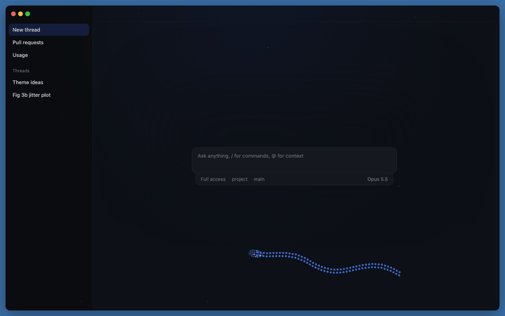
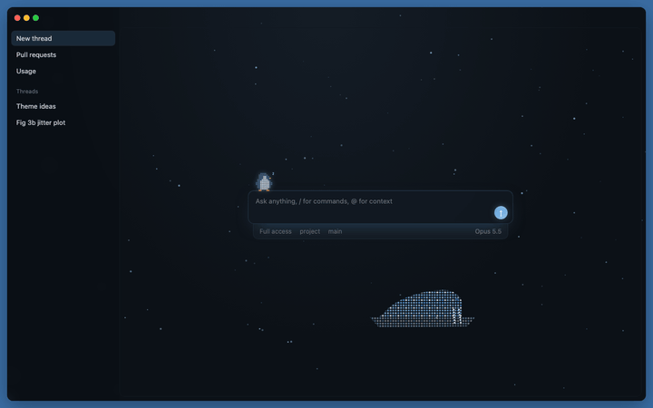
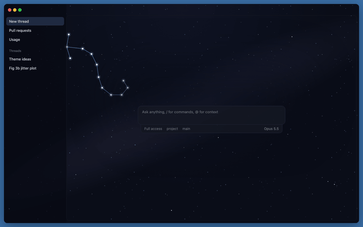
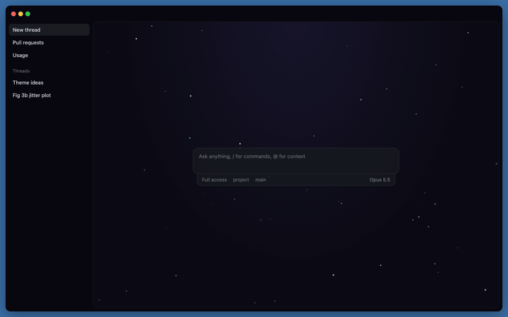
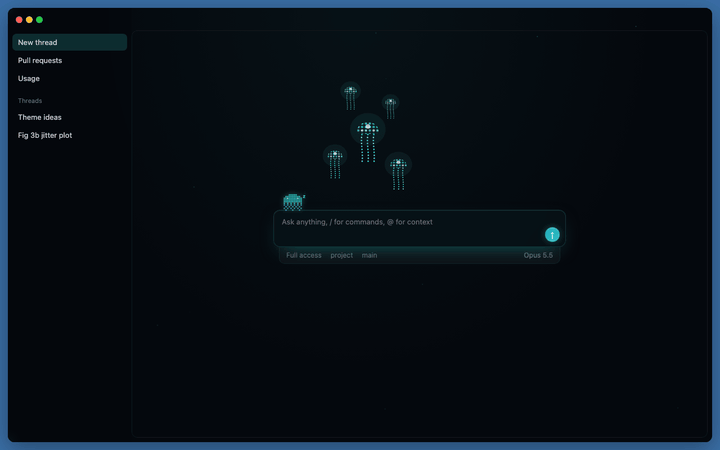
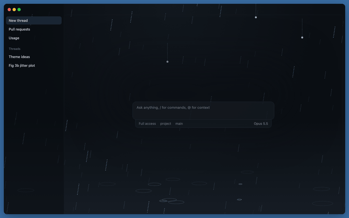
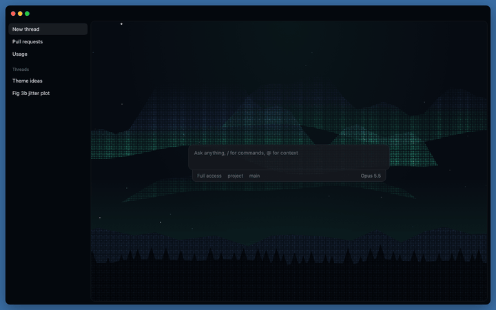

# t3_themes

Animated themes for T3 Code. Each folder holds one theme. Every theme draws a slowly animated, dot-matrix scene behind the chat, dims it once a conversation has messages so text stays readable, and falls back to a plain background when "Reduce motion" is on.

| Theme | Preview |
| --- | --- |
| [**Deep Sea**](deep-sea/)<br>16 sea animals take turns swimming past: sharks, rays, a whale, an anglerfish and more. Dark and light modes. |  |
| [**Arctic**](arctic/)<br>Polar animals in falling snow: orca, narwhal, penguins, a snowy owl, a polar bear on the ice. Dark and light modes. |  |
| [**Night Sky**](night-sky/)<br>A calm starfield where constellations slowly draw themselves, with shooting stars, a comet and a drifting satellite. |  |
| [**Deep Space**](deep-space/)<br>Comets, a ringed planet, a tumbling astronaut, a UFO, a space station and a space whale drift through the stars. |  |
| [**Bioluminescence**](bioluminescence/)<br>The dark abyss, where jellyfish, siphonophores, comb jellies and lanternfish glow cyan. |  |
| [**Night Rain**](night-rain/)<br>Layered rain, ripples, drops on the glass and far-off lightning, with an occasional paper boat or umbrella. Dark and light modes. |  |
| [**Aurora**](aurora/)<br>Rippling green-to-violet northern lights over a pine forest under the stars. |  |

## Installing a theme

T3 Code themes are applied through its built-in theme tool, so the easiest way is to ask the agent in a T3 Code thread:

> Apply the T3 theme in `deep-sea/theme.json` from this repo, with theme id `deep-sea`.

`theme.json` is the full object the tool expects: name, appearance, base colors, and custom CSS. To undo, switch back to a built-in theme such as `t3-chat` or `ocean`.

Themes apply to the desktop and web apps. The T3 mobile app does not use custom themes.

## Repo layout

```
common/
  themekit.py     # shared building blocks: dot patterns, the take-turns "parade", CSS assembly, size checks
  preview.py      # renders each theme's screenshots and GIFs through its real CSS in headless Chrome
<theme-name>/
  theme.json      # the theme as T3 applies it (generated)
  theme.css       # the theme's custom CSS alone (generated)
  background.svg  # the animated background on its own (generated)
  generate.py     # source; edit this, then run it to rebuild the files above
  preview/        # screenshots and GIFs for the README
```

To rebuild a theme and its previews:

```sh
python3 deep-sea/generate.py
python3 common/preview.py deep-sea      # needs Google Chrome and ffmpeg
```

## How the animation stays unpredictable

Themes can't run code, so there's no true randomness. Instead, `themekit.parade()` bakes several rounds into one long loop. Each round plays the cast in a freshly shuffled order, and every pass uses a different lane across the screen. Deep Sea's loop, for example, is 14 minutes long before anything repeats.

## Limits worth knowing

- A theme's custom CSS can be at most 20,000 characters. `themekit.write_theme()` refuses to write a theme that's over.
- CSS cannot load files, so the background is an animated SVG embedded as a `data:` URL.
- One XML error in that SVG blanks the whole background, so `themekit.build_svg()` validates it.
- Only the stable selectors T3 documents (such as `[data-workspace-area="conversation"]`) are safe to target; other class names change between releases.
- The previews are rendered in a T3-style window mockup, not captured from the app itself.

## License

MIT. See [LICENSE](LICENSE).
