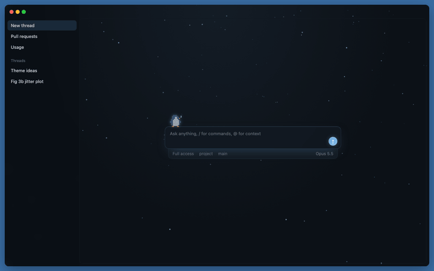
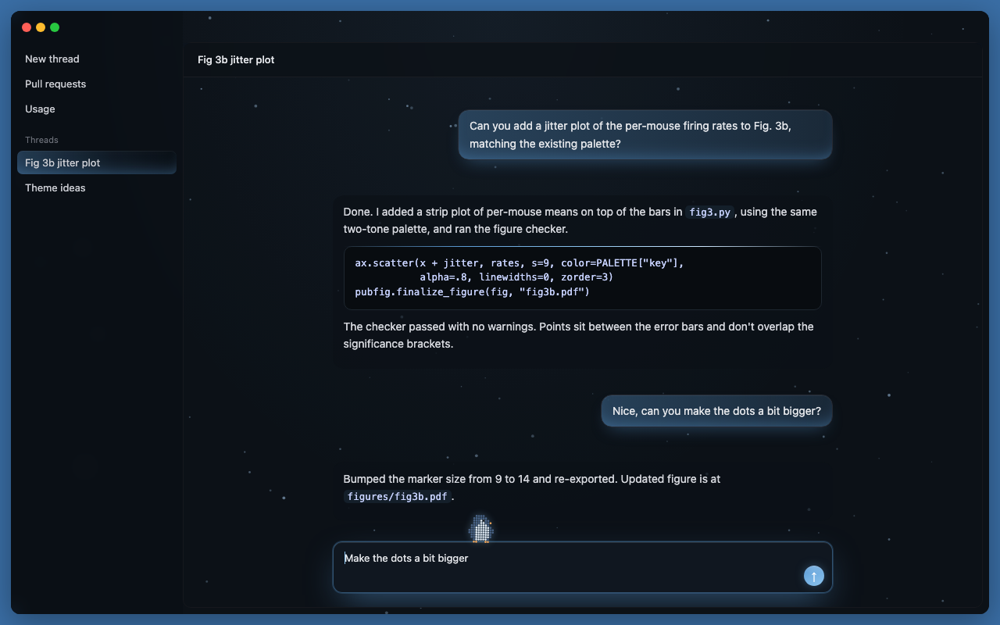
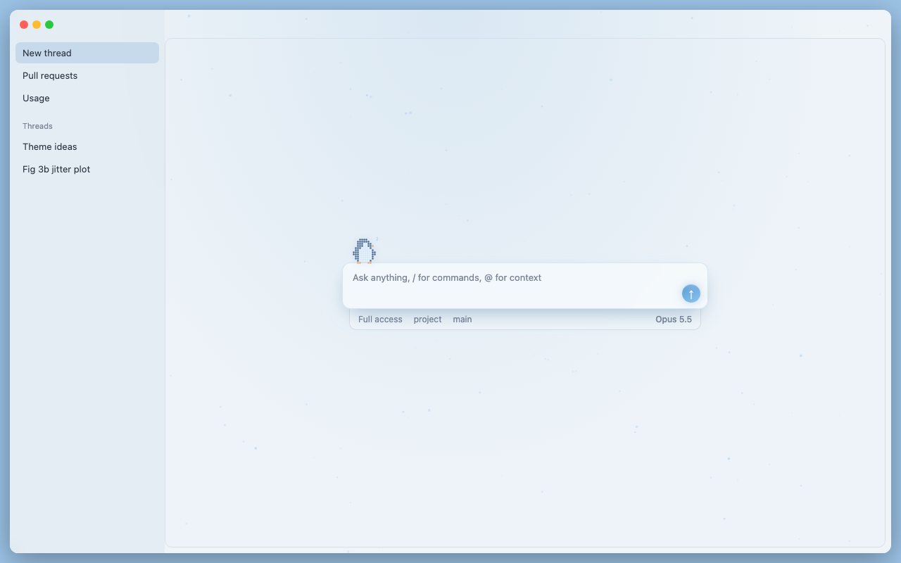
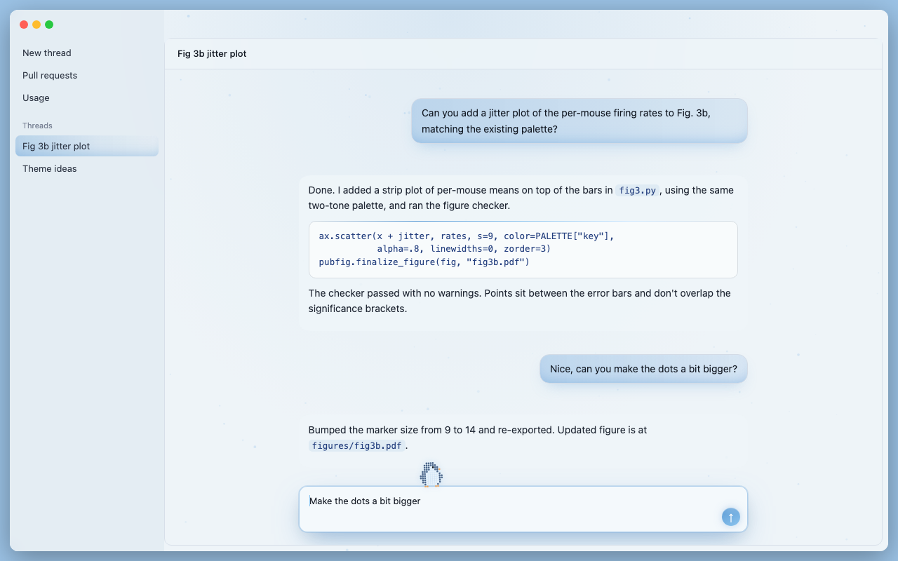

# Arctic Calm

[Arctic](../arctic/) with nothing crossing the screen: falling snow over deep slate, without the polar animals. Same colors, glass, reading cards and companion (a penguin on the composer), and the same light mode. For when you like the look but want the background to stay quiet.



## Screenshots

| | New thread | Inside a conversation |
| --- | --- | --- |
| **Dark** |  |  |
| **Light** |  |  |

## Inside a conversation


If your system's "Reduce motion" setting is on, the animation is replaced with a plain background.

## Editing

This folder is written by [`../arctic/generate.py`](../arctic/generate.py), together with Arctic; edit the scene there. Then, from the repo root:

```sh
python3 arctic/generate.py
python3 common/preview.py arctic-calm --still 40
```
