# Arctic

A deep slate theme with dot-matrix polar animals crossing behind the whole window while snow falls, plus a pale snowy-daylight light mode. One animal crosses at a time, and the next one starts entering a few seconds before the last one leaves, so at most two are on screen. Each loop plays three rounds in a different shuffled order, with every animal on a different route each time (swimmers and flyers swoop and curve; walkers stay on the ice), so it takes about 9½ minutes to repeat.

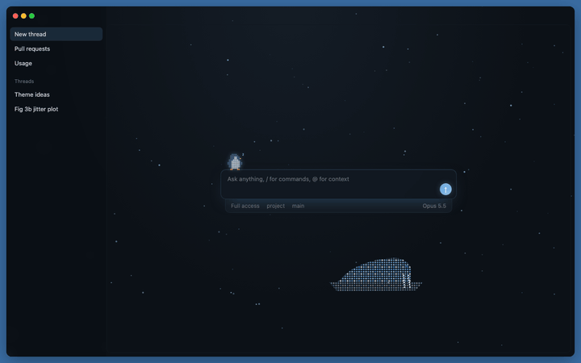

## Screenshots

| | New thread | Inside a conversation |
| --- | --- | --- |
| **Dark** | 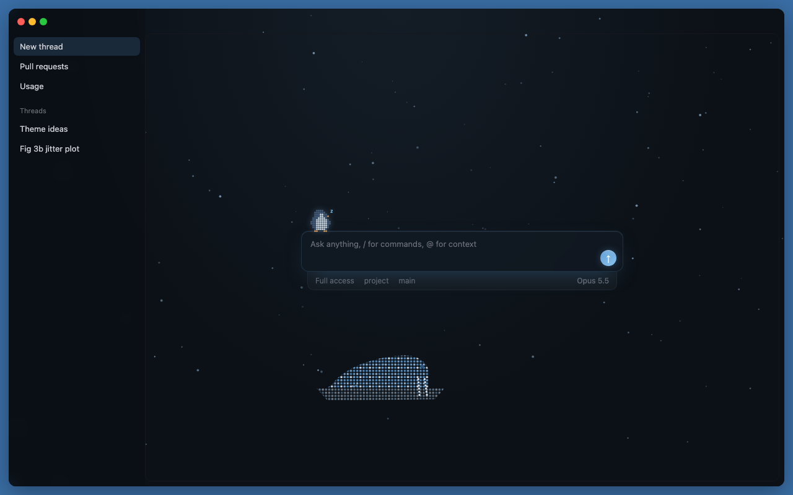 | 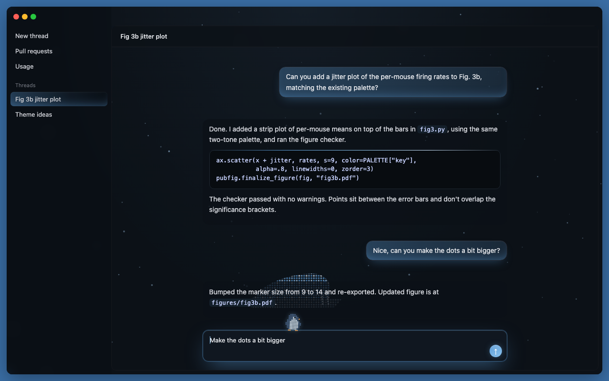 |
| **Light** | 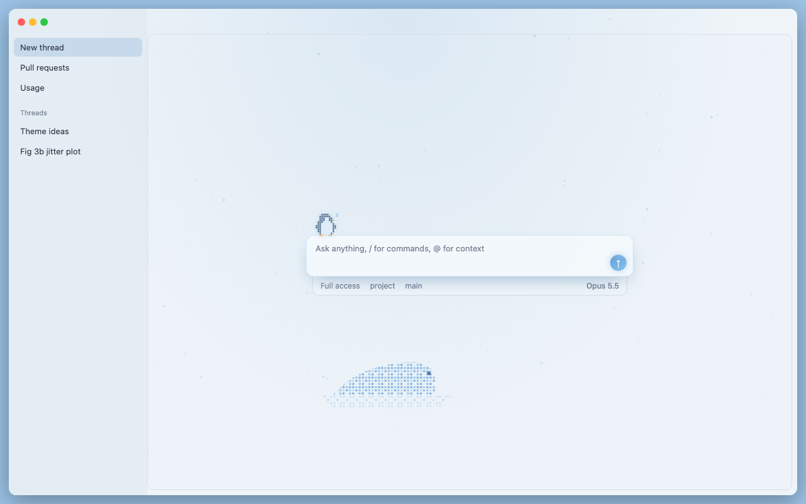 | 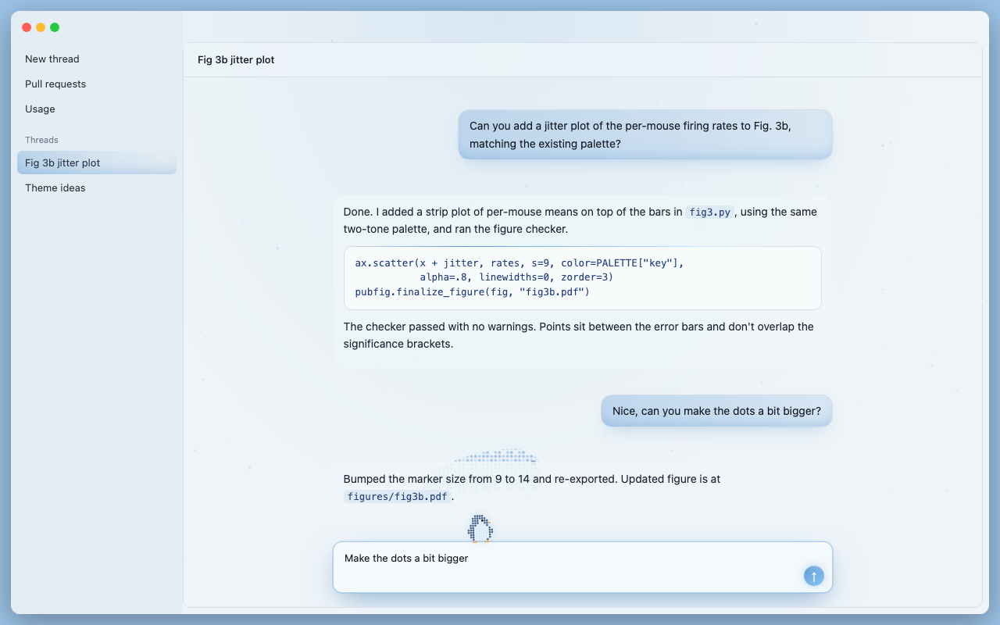 |

## Light mode

Dark is the theme's main appearance. When T3 is set to light (or follows a light system setting), the same animals cross pale ice-blue daylight, slightly softened. The snow mostly disappears against the light background, as snow does in daylight.

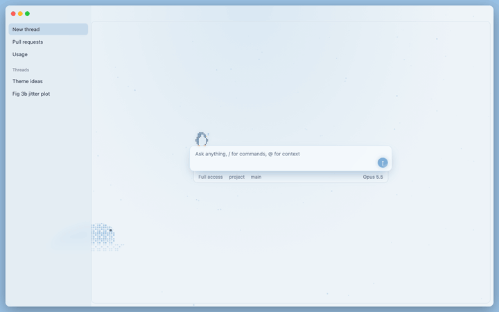

## More of the parade

| Penguins | Orca | Snowy owl |
| --- | --- | --- |
| 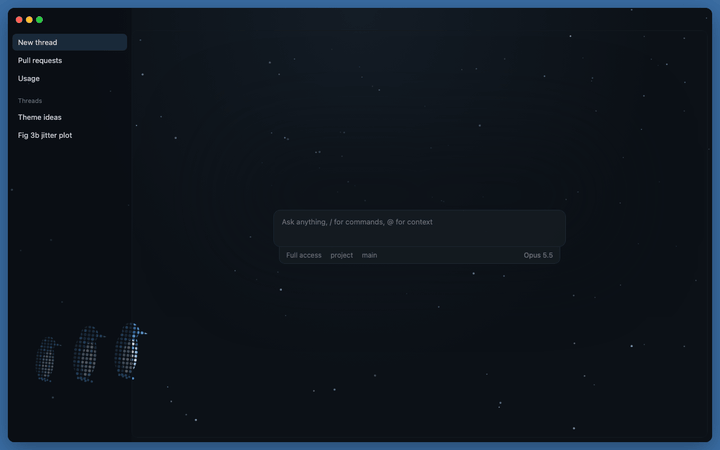 | 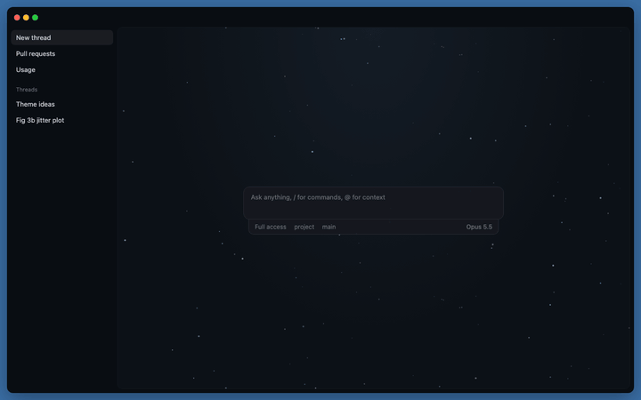 | 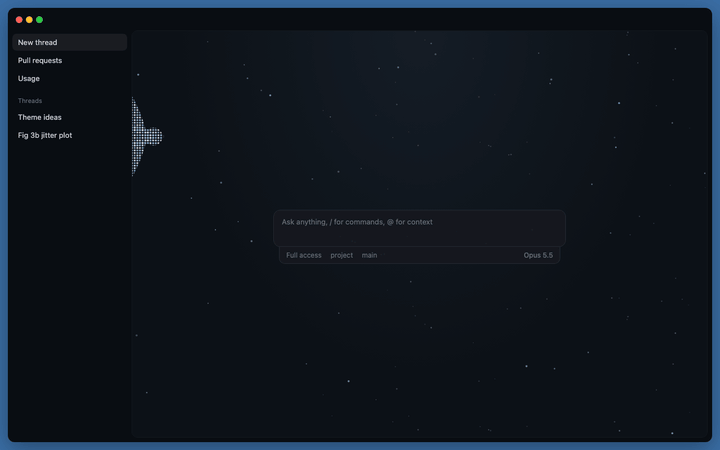 |

## Animals

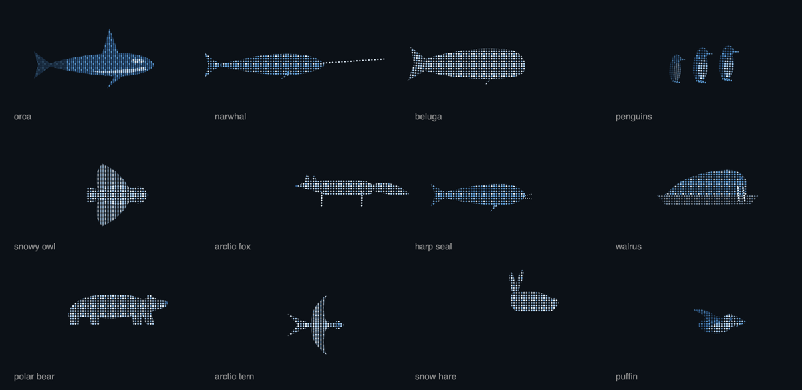

Orca, narwhal, beluga, a waddle of penguins, snowy owl, arctic fox, harp seal, walrus (lounging on a drifting ice floe), polar bear, arctic tern, snow hare and puffin.

Each one has its own motion: the penguins waddle, the fox trots, the hare bounds, the polar bear lumbers, the walrus breathes on its floe, the owl, tern and puffin beat their wings, and the beluga and narwhal swish their tails and flippers. Snow falls in two layers at different speeds, swaying slightly.

## Inside a conversation

Once a thread has messages, the animals dim so they don't compete with the text. The empty new-thread page shows them at full strength.

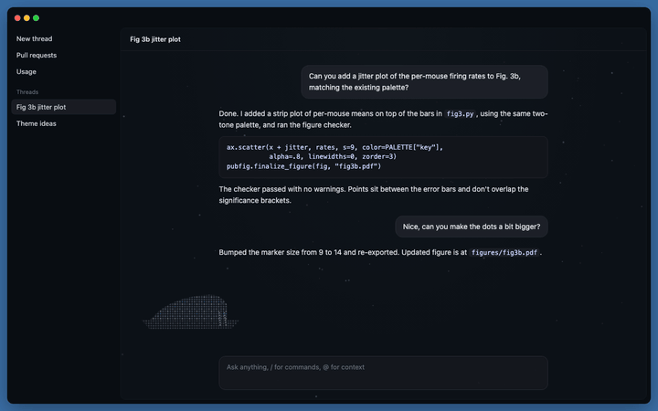

If your system's "Reduce motion" setting is on, the animation is replaced with a plain background (slate or pale ice, depending on the mode).

## How it works

The background is one animated SVG embedded in the theme CSS, built with the shared toolkit in [`../common/themekit.py`](../common/themekit.py).

- The animals are `Actor`s in a `parade`: three shuffled rounds on one timeline, with each pass on a new lane and bent into its own curve (walkers use `wander=0`).
- The dot-matrix look comes from three SVG `<pattern>` fills: ice blue for bodies, navy for dark markings (orca, penguins, puffin), and near-white for snowy fur and feathers.
- Birds are drawn seen from below with their wings spread; flapping squashes the wingspan. Ground animals walk along the bottom upright, mirrored when they head left.
- Snow is one tile of flakes, scrolled downward in two layers at different speeds and scales, each swaying side to side.

## About the previews

The screenshots and GIFs are rendered in Chrome from the theme's own CSS, placed inside a T3-style window mockup, with [`../common/preview.py`](../common/preview.py). They aren't captures of the T3 Code app itself. The GIFs play in real time.

## Editing

All the shapes, paths, timings and colors live in `generate.py`. After changing it, run from the repo root:

```sh
python3 arctic/generate.py
python3 common/preview.py arctic --still 155.5 --clip penguins:108:14 --clip orca:149:12 --clip owl:180:12
```

The first command rewrites `background.svg`, `theme.css`, `theme.json`, `preview/gallery.svg` and `preview/timeline.json`, and checks the SVG is valid and the CSS stays under T3's 50,000-character limit. It currently uses about 19,900. The second re-renders the previews; `preview/timeline.json` lists when each animal crosses, for picking clip times.

To add an animal, draw its body facing +x with its head near the origin and add an `Actor` to the `cast` list. Use `flip=True` for side-view animals that travel right to left, and `rotate=False` plus `face_left()` for upright walkers heading left.
