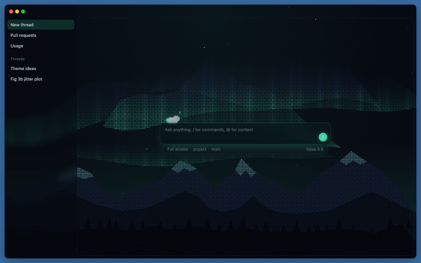
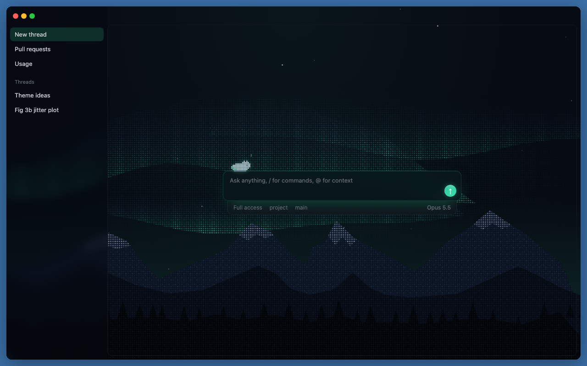
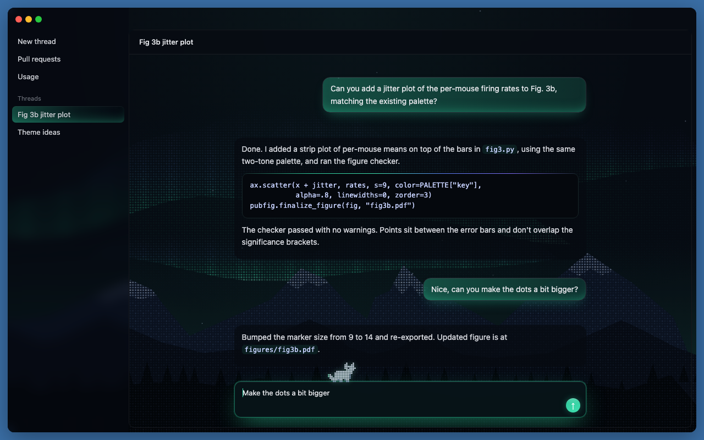
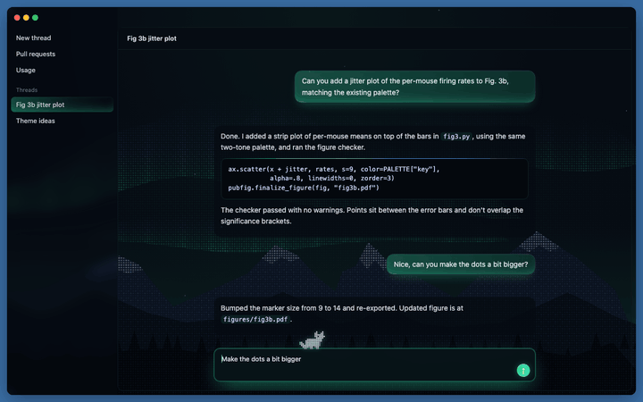

# Aurora Calm

[Aurora](../aurora/) with nothing crossing the screen: the rippling northern lights over snow-capped mountains, a pine forest and twinkling stars, without the birds, shooting stars, fireball and satellite. Same colors, glass, reading cards and companion (an arctic fox on the composer). For when you like the look but want the background to stay quiet.



## Screenshots

| | New thread | Inside a conversation |
| --- | --- | --- |
| **Dark** |  |  |

## Inside a conversation



If your system's "Reduce motion" setting is on, the animation is replaced with a plain background.

## Editing

This folder is written by [`../aurora/generate.py`](../aurora/generate.py), together with Aurora; edit the scene there. Then, from the repo root:

```sh
python3 aurora/generate.py
python3 common/preview.py aurora-calm --still 40
```
