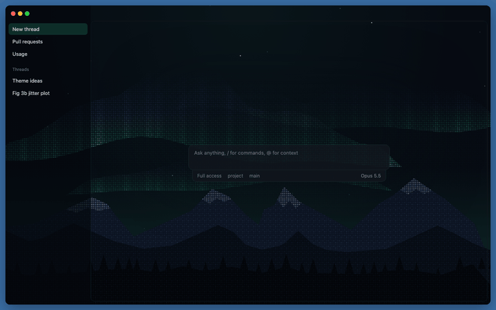

# Aurora

Northern lights in dots. Curtains of green and violet light ripple over snow-capped mountains and a pine forest, under a twinkling starfield. Every so often the aurora flares up and lights the snow green, a shooting star or fireball streaks past, a satellite drifts across, or birds fly by, with long, uneven quiet stretches in between. Dark mode only.


## Screenshots

| New thread | Inside a conversation |
| --- | --- |
|  |  |

## What's in the sky

- **Three aurora curtains** at different heights. Each one's lower edge ripples slowly, and its ragged top fades from bright green through teal and blue into violet. Each curtain changes shape through its own random phases at an uneven tempo and brightens and dims on its own irregular cycle. Vertical rays drift sideways along them, speeding up and slowing down.
- **A rare flare**: a fourth curtain that stays hidden most of the time, then surges up for a few seconds every couple of minutes. The snowcaps catch its green light.
- **Never quite in sync**: every cycle is a different prime number of seconds, so the curtains drift in and out of step and the whole sky takes hours to repeat.
- **A starfield** where some stars twinkle.
- **The horizon**: a far range of jagged, snow-capped peaks, a darker nearer range, and a ridge of pine silhouettes in front, with a faint green glow where the aurora meets the mountains.
- **Occasional visitors**: two kinds of shooting star, a slower green fireball, a blinking satellite, and two flocks of birds with flapping wings. They come in three shuffled rounds with 20 to 50 seconds of quiet sky between them. The birds take a different curving route every time. The full loop is about 16 minutes.

| Birds crossing | Fireball |
| --- | --- |
|  |  |

## Inside a conversation

Once a thread has messages, the sky dims so the text stays readable. The empty new-thread page shows it at full strength.


If your system's "Reduce motion" setting is on, the animation is replaced with a plain night-blue background.

## How it works

Like the other themes here, the whole sky is one animated SVG embedded in the theme CSS; see [`../common/themekit.py`](../common/themekit.py) for the shared pieces.

- Each curtain is a single ribbon shape whose outline is animated through four random phases with eased, unevenly spaced timing, so it ripples without ever going flat. The ribbon tapers to points at both ends. Its outline uses relative coordinates, which keeps the four phases small enough to fit.
- One gradient, stretched over each curtain's own bounding box, colors all of them.
- The mountains are generated: peaks of random height and spacing, two jittered kinks on every slope, and a ragged snowcap on each far peak.
- Two masks shape the whole sky. A horizontally repeating gradient that slowly drifts creates the vertical rays. A fixed grid of dots then turns everything into the dot-matrix look, so the light appears to move across stationary dots.
- No blur filters are used, which keeps the constantly redrawn background cheap.
- The visitors use the shared `parade()` scheduler with a negative overlap and `jitter`, which leaves uneven gaps of quiet sky between them.

## About the previews

The screenshots and GIFs are rendered in Chrome from the theme's own CSS, inside a T3-style window mockup. They aren't captures of the T3 Code app itself. The GIFs play in real time.

## Editing

Colors, curtain shapes, the horizon and the visitors all live in `generate.py`. After changing it, run:

```sh
python3 generate.py
python3 ../common/preview.py .      # optional: re-render the previews
```

The CSS currently uses about 22,100 of T3's 50,000 characters. Most of it goes to the curtains' animated outlines and the stars.
