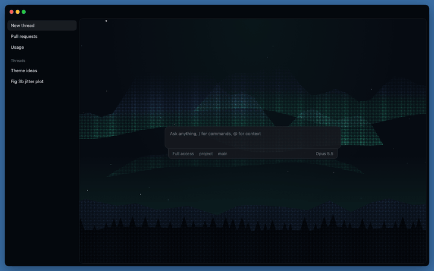
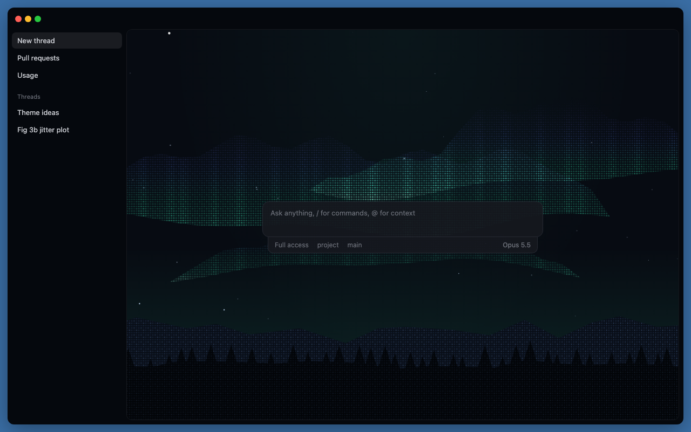
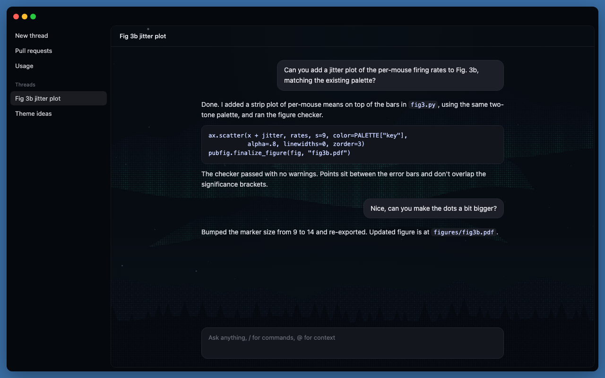
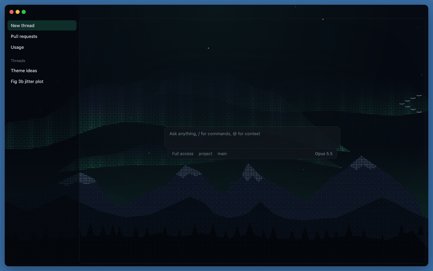
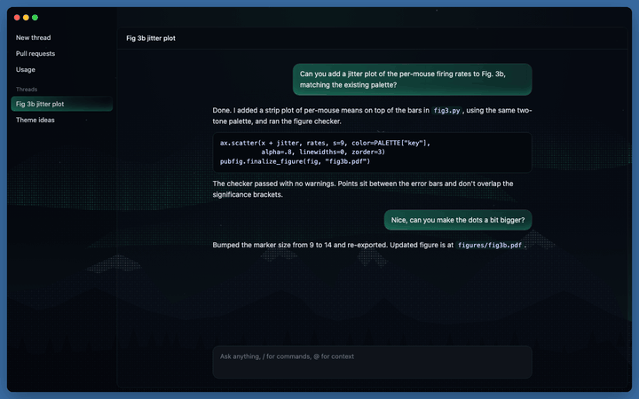

# Aurora

Northern lights in dots. Curtains of green and violet light ripple over a dotted mountain range and a pine forest, under a twinkling starfield. Every so often a shooting star streaks past, a satellite drifts across, or a flock of birds flies by, with long quiet stretches in between. Dark mode only.



## Screenshots

| New thread | Inside a conversation |
| --- | --- |
|  |  |

## What's in the sky

- **Three aurora curtains** at different heights. Each one's lower edge ripples slowly, and its ragged top fades from bright green through teal and blue into violet. Vertical rays drift sideways along them, and each curtain brightens and dims on its own one-to-two-minute cycle, so the sky never looks quite the same twice.
- **A starfield** where some stars twinkle.
- **The horizon**: a dotted far ridge and a near ridge of pine silhouettes, with a faint green glow where the aurora meets the mountains.
- **Occasional visitors**: two kinds of shooting star, a blinking satellite, and a flock of birds with flapping wings. They come in three shuffled rounds with about 20 seconds of quiet sky between them, and each pass takes a different route. The full loop is about 8 minutes.



## Inside a conversation

Once a thread has messages, the sky dims so the text stays readable. The empty new-thread page shows it at full strength.



If your system's "Reduce motion" setting is on, the animation is replaced with a plain night-blue background.

## How it works

Like the other themes here, the whole sky is one animated SVG embedded in the theme CSS; see [`../common/themekit.py`](../common/themekit.py) for the shared pieces.

- Each curtain is a single ribbon shape whose outline is animated through three phases (with eased timing), so it ripples without ever going flat. The ribbon tapers to points at both ends.
- Two masks shape the whole sky. A horizontally repeating gradient that slowly drifts creates the vertical rays. A fixed grid of dots then turns everything into the dot-matrix look, so the light appears to move across stationary dots.
- No blur filters are used, which keeps the constantly redrawn background cheap.
- The visitors use the shared `parade()` scheduler with a negative overlap, which leaves gaps of quiet sky between them.

## About the previews

The screenshots and GIFs are rendered in Chrome from the theme's own CSS, inside a T3-style window mockup. They aren't captures of the T3 Code app itself. The GIFs play in real time.

## Editing

Colors, curtain shapes, the horizon and the visitors all live in `generate.py`. After changing it, run:

```sh
python3 generate.py
python3 ../common/preview.py .      # optional: re-render the previews
```

The CSS currently uses about 19,800 of T3's 20,000 characters. Most of it goes to the curtains' animated outlines and the stars, so to add something, trim stars or the ribbon detail (`step` in `ribbon_phase`) first.
