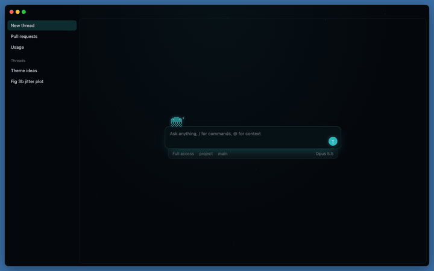
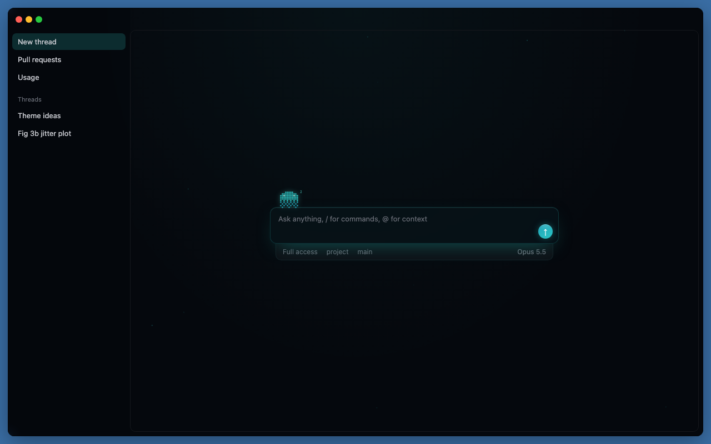
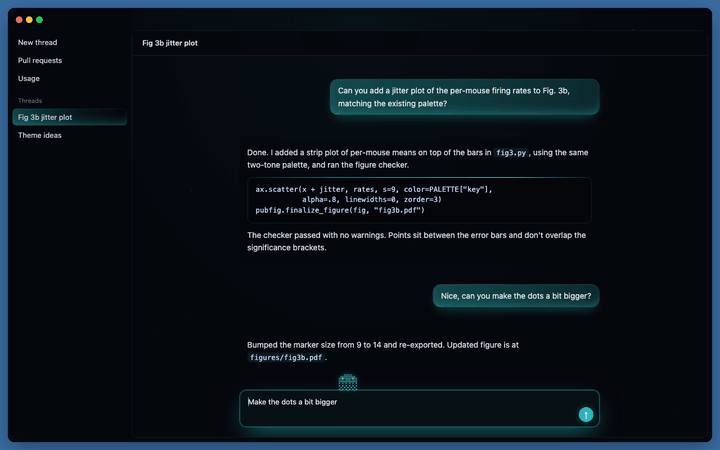

# Bioluminescence Calm

[Bioluminescence](../bioluminescence/) with nothing crossing the screen: glowing marine snow sinking through the dark abyss, without the jellyfish, squid and other glowing creatures. Same colors, glass, reading cards and companion (a jellyfish on the composer). For when you like the look but want the background to stay quiet.



## Screenshots

| | New thread | Inside a conversation |
| --- | --- | --- |
| **Dark** |  |  |

## Inside a conversation



If your system's "Reduce motion" setting is on, the animation is replaced with a plain background.

## Editing

This folder is written by [`../bioluminescence/generate.py`](../bioluminescence/generate.py), together with Bioluminescence; edit the scene there. Then, from the repo root:

```sh
python3 bioluminescence/generate.py
python3 common/preview.py bioluminescence-calm --still 40
```
