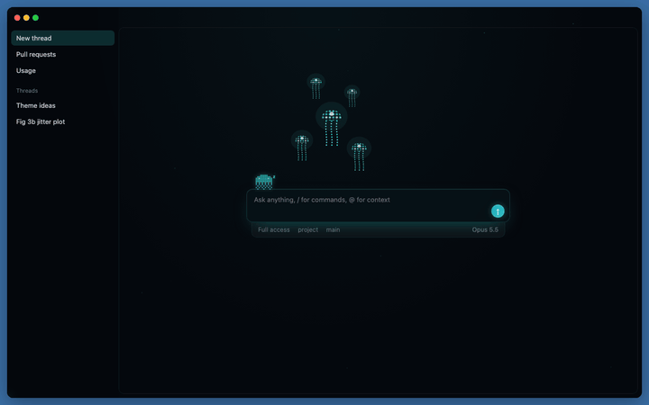
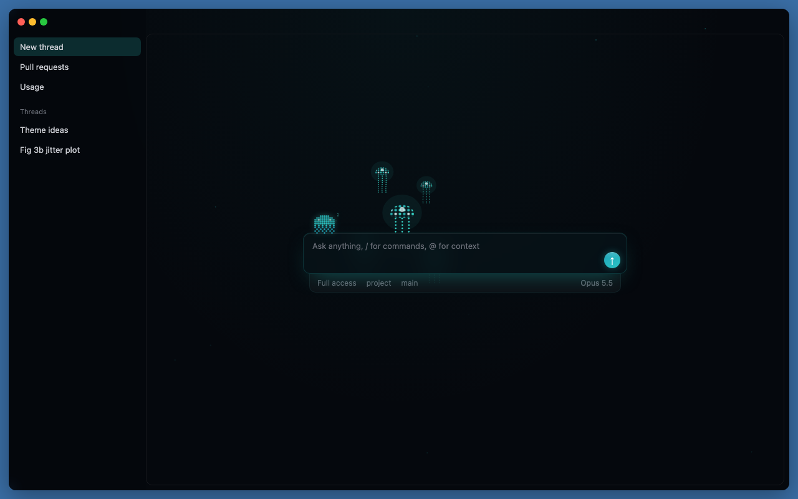
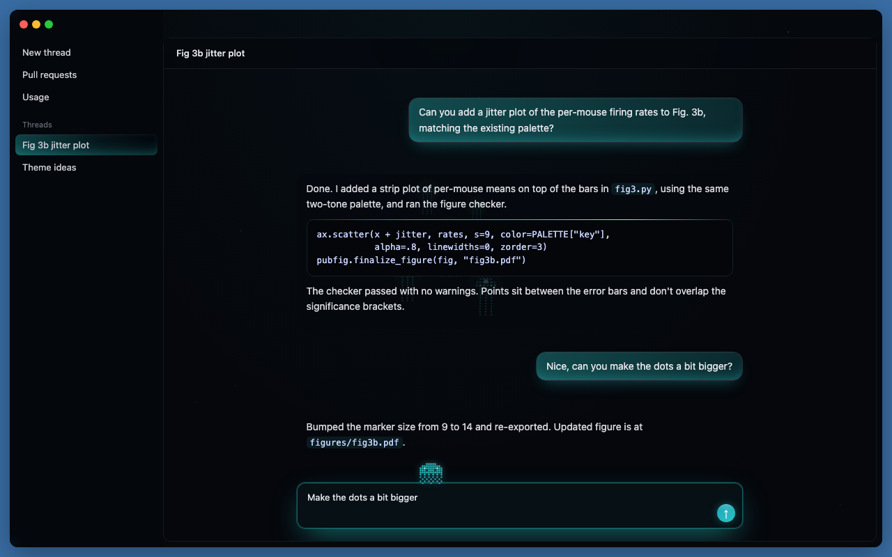
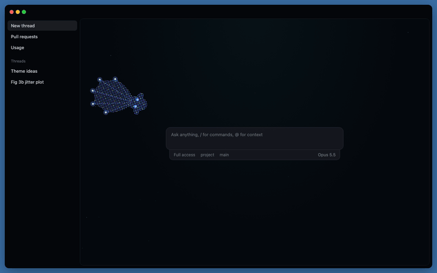
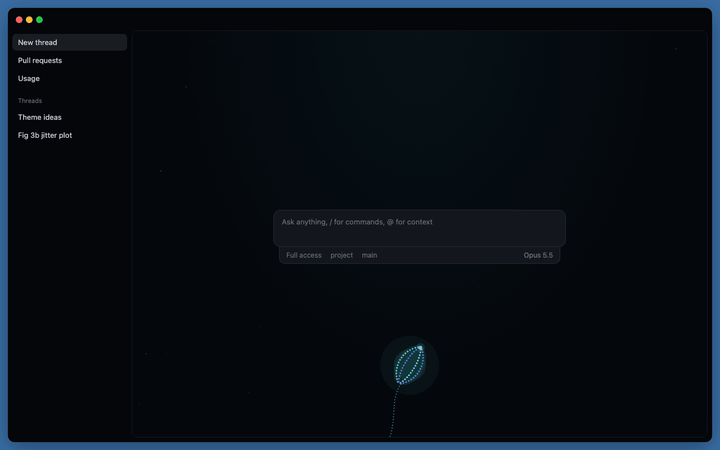
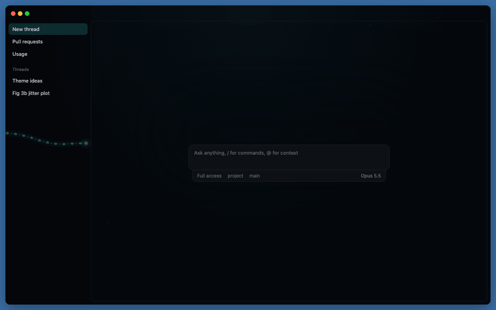
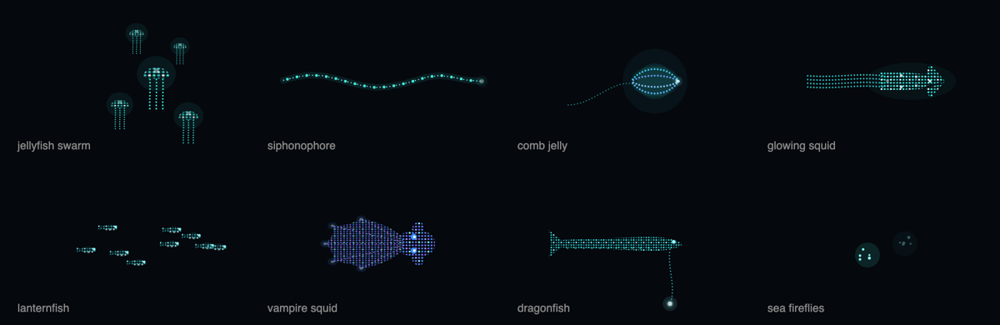
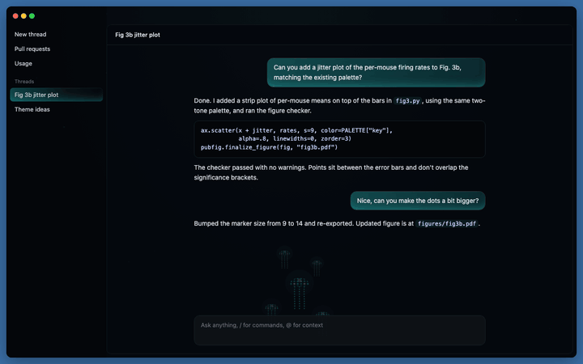

# Bioluminescence

The deep abyss, darker than [Deep Sea](../deep-sea/), where every creature makes its own light. Glowing animals take turns drifting behind the whole window: one crosses at a time, and the next starts arriving a few seconds before the last one leaves, so at most two are on screen. The loop runs three rounds, each in a shuffled order with every creature on a different curving route, so it takes about 8 minutes to repeat.

Dark mode only.



## Screenshots

| New thread | Inside a conversation |
| --- | --- |
|  |  |

## More of the cast

| Vampire squid | Comb jelly | Siphonophore |
| --- | --- | --- |
|  |  |  |

## Creatures



- **Jellyfish swarm:** five small jellies with pulsing bells, glowing cores and swaying tentacles, bobbing out of step as they rise.
- **Siphonophore:** a long colonial string that undulates while pulses of light run down its segments.
- **Comb jelly:** a translucent oval whose comb rows shimmer through cyan, violet and blue.
- **Glowing squid:** dotted arms trailing a lit mantle whose photophores flicker.
- **Lanternfish:** a small school of dim fish with blinking rows of belly lights.
- **Vampire squid:** a violet dome with ear-like fins, opening and closing a webbed cloak tipped with blue lights.
- **Dragonfish:** a dark, slender hunter with a row of flank lights and a glowing lure dangling from its chin.
- **Sea fireflies:** tiny ostracods that flash in little bursts, one cluster after another, leaving a fading trail.

Faint particles of marine snow drift through the dark between them.

## Inside a conversation

Once a thread has messages, each block of chat sits on its own dark reading card, so the glowing creatures stay bright around the text without competing with it.



If your system's "Reduce motion" setting is on, the animation is replaced with a plain abyss-black background.

## How it works

The background is one animated SVG embedded in the theme CSS, built with the shared toolkit in [`../common/themekit.py`](../common/themekit.py) (see [Deep Sea](../deep-sea/README.md#how-it-works) for the general approach).

- Glows are faked with stacked translucent shapes and opacity pulses rather than SVG blur filters, which would be expensive in a background that redraws every frame.
- Light pulses travel along the siphonophore by animating `stroke-dashoffset` on a dotted stroke; the comb jelly's rows shimmer by animating their `stroke` color, each row a little out of phase.
- The siphonophore bends with a travelling sine wave sampled at four phases, so it never goes flat mid-animation.

## About the previews

The screenshots and GIFs are rendered in Chrome from the theme's own CSS, placed inside a T3-style window mockup by [`../common/preview.py`](../common/preview.py). They aren't captures of the T3 Code app itself. The GIFs play in real time.

## Editing

All the shapes, paths, timings and colors live in `generate.py`. After changing it, run:

```sh
python3 generate.py
python3 ../common/preview.py .   # optional: refresh the screenshots and GIFs
```

This rewrites `background.svg`, `theme.css`, `theme.json` and `preview/gallery.svg`. The toolkit checks that the SVG is valid XML and that the CSS stays under T3's 50,000-character limit. This theme uses about 22,400. To keep it small, share definitions with `<use>` and group blinking lights under one animation rather than giving each its own.
