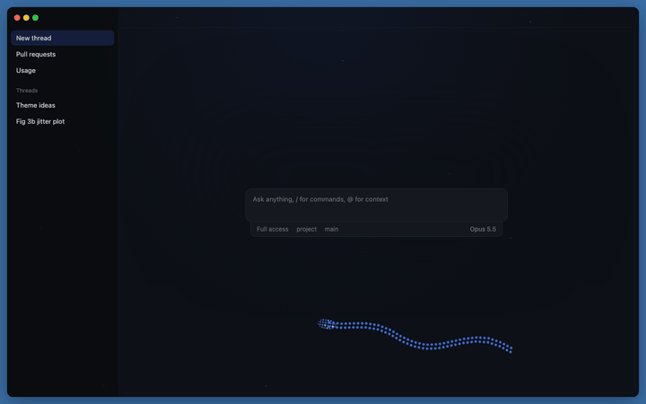
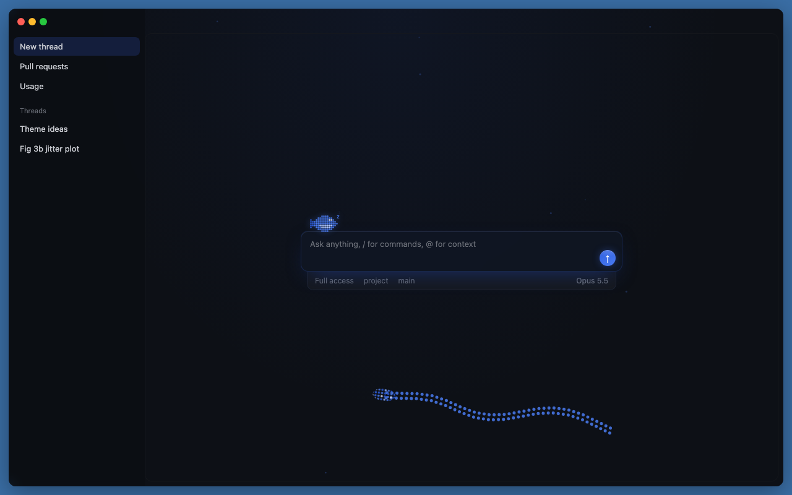
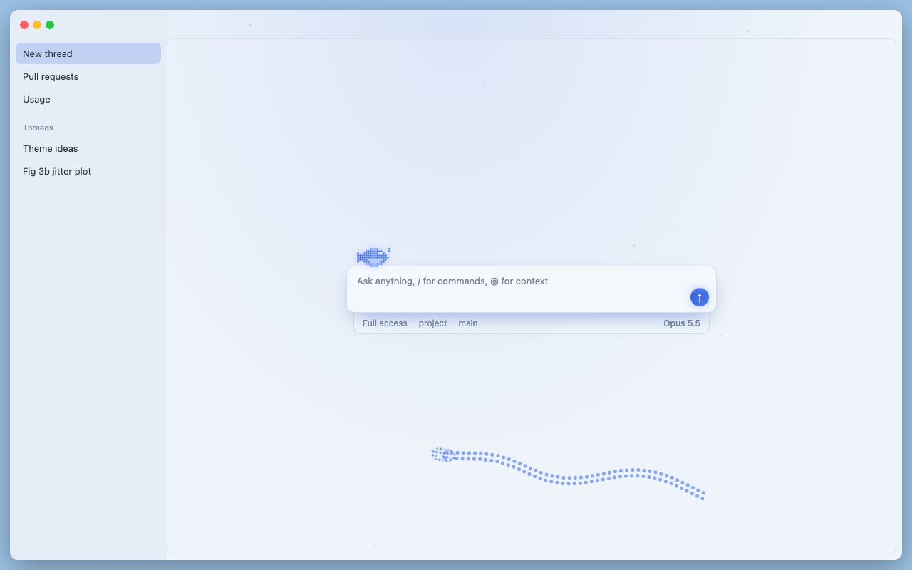
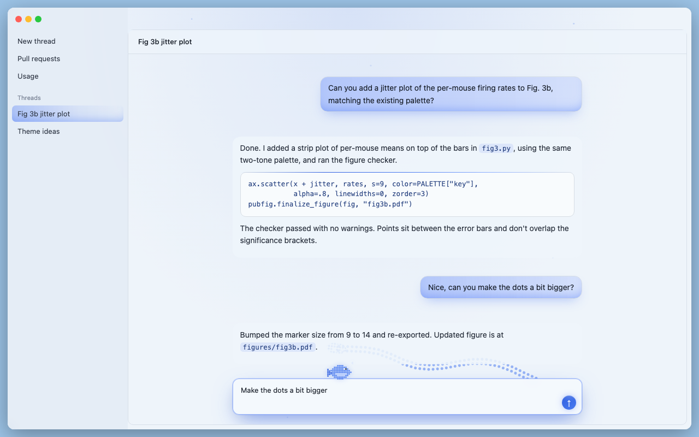
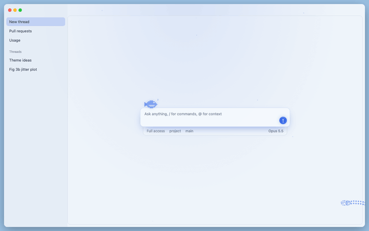
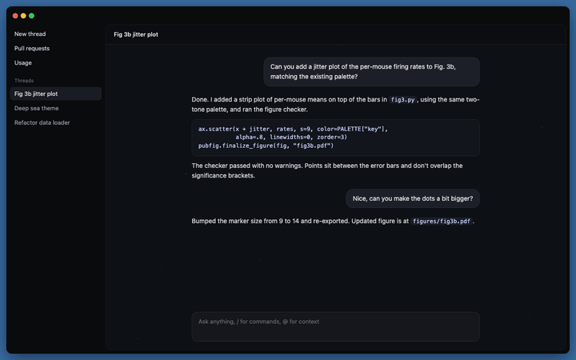

# Deep Sea

A deep navy theme with dot-matrix sea animals swimming behind the whole window, plus a pale sea-foam light mode. One animal crosses at a time, and the next one starts entering a few seconds before the last one leaves, so at most two are on screen. Each animal shows up three times per loop, in a differently shuffled order and on a different curving route each time, so the full loop runs 14 minutes before anything repeats.



## Screenshots

| | New thread | Inside a conversation |
| --- | --- | --- |
| **Dark** |  |  |
| **Light** |  |  |

## Light mode

Dark is the theme's main appearance. When T3 is set to light (or to follow the system and the system is light), the same animals swim over pale sea-foam water, slightly softened so the saturated blue doesn't overpower the page.



## More of the parade

| Jellyfish | Humpback whale | Anglerfish |
| --- | --- | --- |
|  |  |  |

## Animals


The cast: shark, jellyfish, school of fish, sea turtle, swordfish, octopus, humpback whale, seahorse, manta ray, anglerfish, eel, dolphin, hammerhead, pufferfish, squid, crab.

Each one has its own motion: the shark and hammerhead sway their tails, the jellyfish pulses, the turtle paddles, the ray flaps, the whale beats its fluke, the eel wiggles, the anglerfish's lure blinks, the pufferfish puffs up, and the crab scuttles along the bottom. Faint plankton specks drift and twinkle in the background.

## Inside a conversation

Once a thread has messages, the animals dim (to about 40% brightness in dark mode, more in light mode) so they don't compete with the text. The empty new-thread page shows them at full strength.



If your system's "Reduce motion" setting is on, the animation is replaced with a plain background (navy or sea-foam, depending on the mode).

## How it works

T3 themes can't run JavaScript or load files, so the whole background is one animated SVG (using SMIL `<animateMotion>` and `<animate>`) embedded in the theme CSS as a `data:` URL. It's drawn behind the whole window, with the sidebar see-through over it, and falls back to the chat area alone if T3's layout markup changes.

- Every animal shares one 14-minute timeline built by `parade()` in [`../common/themekit.py`](../common/themekit.py). It plays three rounds, each shuffled, and gives each pass its own route: a new lane, bent into random swoops, dips or S-curves (the crab keeps to the sea floor). An animal's motion path is all of its routes joined by move-tos; `keyTimes`/`keyPoints` keep it parked off-screen except during its own windows, which is how the animals take turns.
- The dot-matrix look comes from two SVG `<pattern>` fills (a 3×3 tile of dots in four shades of blue), so each silhouette is just a path filled with dots. Tails and tentacles are dotted strokes (`stroke-dasharray="0 5"` with round caps).
- In conversations, `:has([data-timeline-row-kind])` switches on a light veil, and each `[data-timeline-root]` row gets a dark rounded reading card behind its text.
- Both appearances share one embedded SVG. Light mode (`:root:not(.dark)`) only swaps CSS variables for the water color, glow and veil, which keeps the CSS under T3's size limit. The colors for each mode are the `DARK` and `LIGHT` dictionaries in `generate.py`.

## About the previews

The screenshots and GIFs are rendered by [`../common/preview.py`](../common/preview.py) in headless Chrome from the theme's own CSS (or `background.svg`), placed inside a T3-style window mockup. They aren't captures of the T3 Code app itself. The GIFs play in real time.

## Editing

All the shapes, paths, timings and colors live in `generate.py`. After changing it, run:

```sh
python3 generate.py
```

This rewrites `background.svg`, `theme.css`, `theme.json`, `preview/gallery.svg` and `preview/timeline.json`. To refresh the screenshots and GIFs afterwards, run `python3 ../common/preview.py .` from this folder (needs Chrome and ffmpeg). The script checks that the SVG is valid XML (one bad attribute blanks the whole background) and that the CSS stays under T3's 50,000-character limit. It currently uses about 22,400.

To add an animal, define its body facing +x with its head near the origin, then add an `Actor` to the `cast` list:

```python
Actor(name, body, scale, seconds_on_screen, motion_path, rotate=True, flip=False, opacity=.9, lanes=None)
```

Set `flip=True` for side-view animals that swim right to left, so they don't end up upside down. `lanes` sets how far each pass may shift from the base route and `wander` how far it may bend away from it (0 for a fixed shape); see the `Actor` docstring in `themekit.py`.
