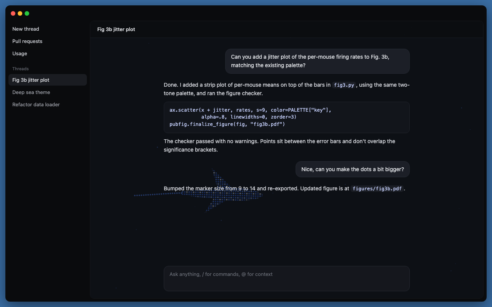
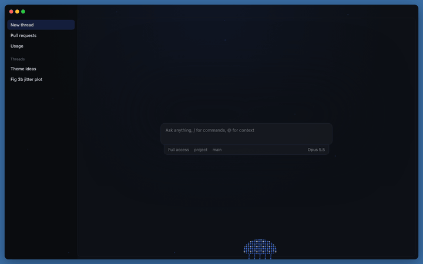
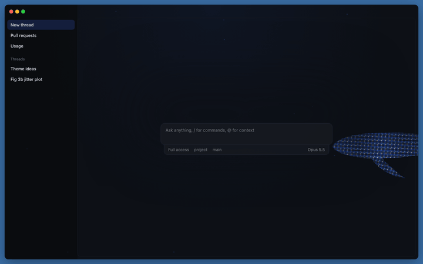
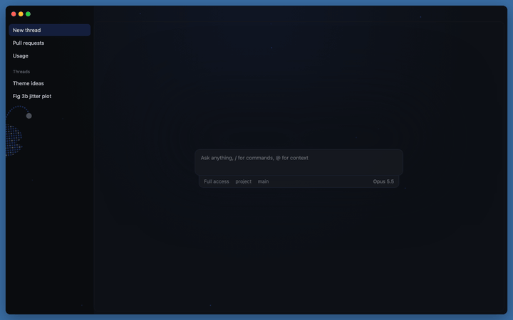
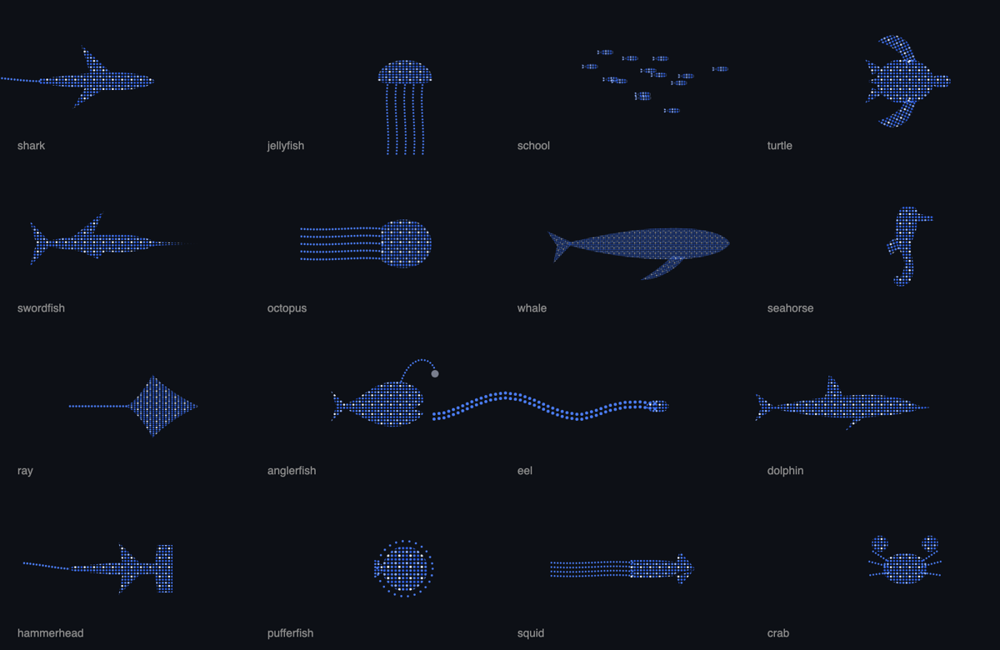

# Deep Sea

A dark navy theme with dot-matrix sea animals swimming behind the chat. One animal crosses at a time, and the next one starts entering a few seconds before the last one leaves, so at most two are on screen. The full loop is about 4¾ minutes.


## Screenshots

| New thread | Inside a conversation |
| --- | --- |
|  |  |

## More of the parade

| Jellyfish | Humpback whale | Anglerfish |
| --- | --- | --- |
|  |  |  |

## Animals



In order: shark, jellyfish, school of fish, sea turtle, swordfish, octopus, humpback whale, seahorse, manta ray, anglerfish, eel, dolphin, hammerhead, pufferfish, squid, crab.

Each one has its own motion: the shark and hammerhead sway their tails, the jellyfish pulses, the turtle paddles, the ray flaps, the whale beats its fluke, the eel wiggles, the anglerfish's lure blinks, the pufferfish puffs up, and the crab scuttles along the bottom. Faint plankton specks drift and twinkle in the background.

## Inside a conversation

Once a thread has messages, the animals dim to about 40% brightness so they don't compete with the text. The empty new-thread page shows them at full brightness.


If your system's "Reduce motion" setting is on, the animation is replaced with a plain dark background.

## How it works

T3 themes can't run JavaScript or load files, so the whole background is one animated SVG (using SMIL `<animateMotion>` and `<animate>`) embedded in the theme CSS as a `data:` URL on `[data-workspace-area="conversation"]`.

- Every animal shares one timeline the length of the full loop. `keyTimes`/`keyPoints` keep each animal parked off-screen except during its own window, which is how they take turns.
- The dot-matrix look comes from two SVG `<pattern>` fills (a 3×3 tile of dots in four shades of blue), so each silhouette is just a path filled with dots. Tails and tentacles are dotted strokes (`stroke-dasharray="0 5"` with round caps).
- Dimming in conversations uses `:has([data-timeline-row-kind])` to switch a translucent layer on top of the background.

## About the previews

The screenshots and GIFs are rendered in Chrome from `background.svg`, placed inside a T3-style window mockup. They aren't captures of the T3 Code app itself. The GIFs play in real time.

## Editing

All the shapes, paths, timings and colors live in `generate.py`. After changing it, run:

```sh
python3 generate.py
```

This rewrites `background.svg`, `theme.css`, `theme.json` and `preview/gallery.svg`. The script checks that the SVG is valid XML (one bad attribute blanks the whole background) and that the CSS stays under T3's 20,000-character limit. It currently uses about 18,400.

To add an animal, define its body facing +x with its head near the origin, then add a row to the `parade` list:

```python
(name, body, scale, seconds_on_screen, motion_path, rotate_along_path, flip_upright, opacity)
```

Set `flip_upright` for side-view animals that swim right to left, so they don't end up upside down.
