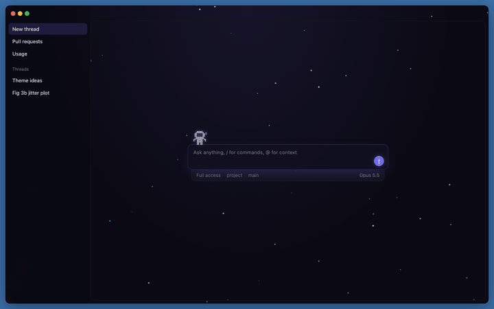
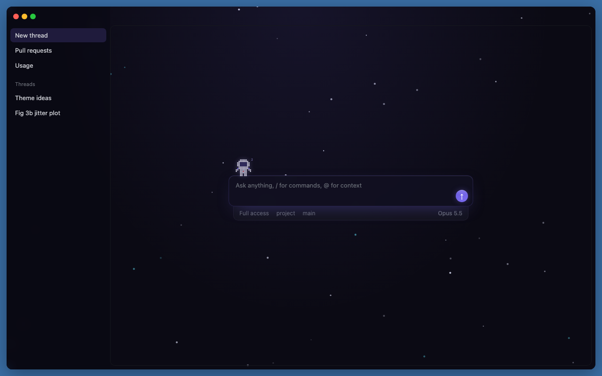
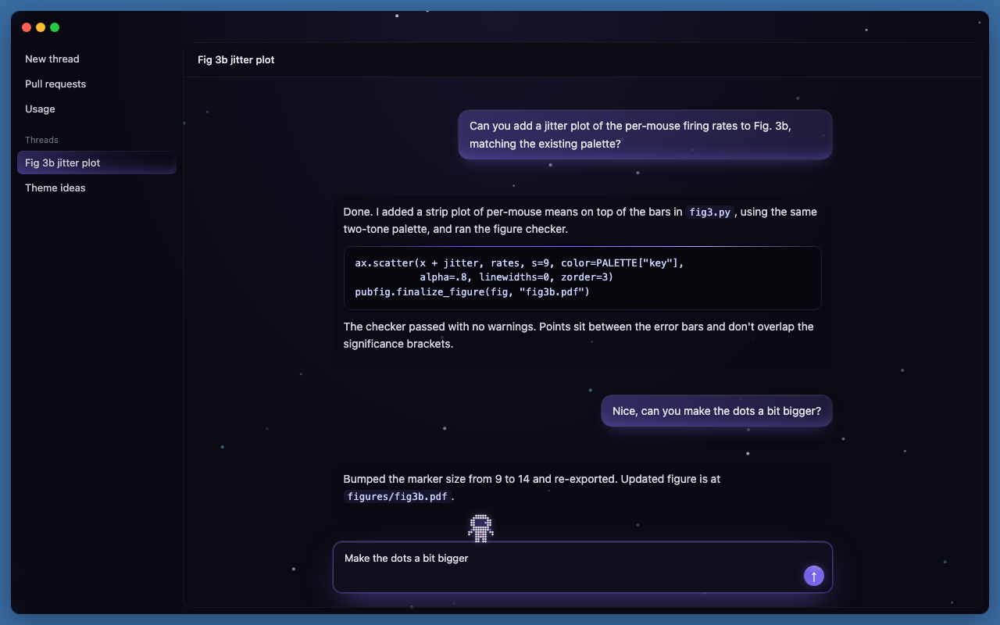
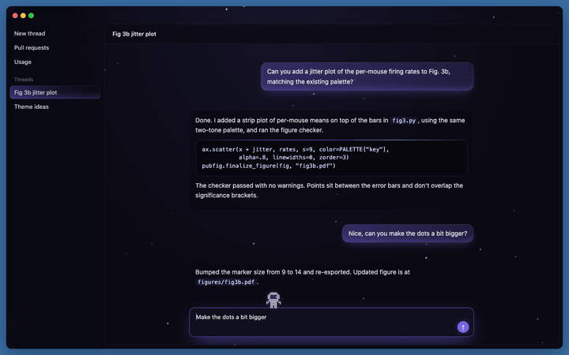

# Deep Space Calm

[Deep Space](../deep-space/) with nothing crossing the screen: a twinkling starfield, without the comets, planets, astronaut, UFO, space station and space whale. Same colors, glass, reading cards and companion (an astronaut on the composer). For when you like the look but want the background to stay quiet.



## Screenshots

| | New thread | Inside a conversation |
| --- | --- | --- |
| **Dark** |  |  |

## Inside a conversation



If your system's "Reduce motion" setting is on, the animation is replaced with a plain background.

## Editing

This folder is written by [`../deep-space/generate.py`](../deep-space/generate.py), together with Deep Space; edit the scene there. Then, from the repo root:

```sh
python3 deep-space/generate.py
python3 common/preview.py deep-space-calm --still 40
```
