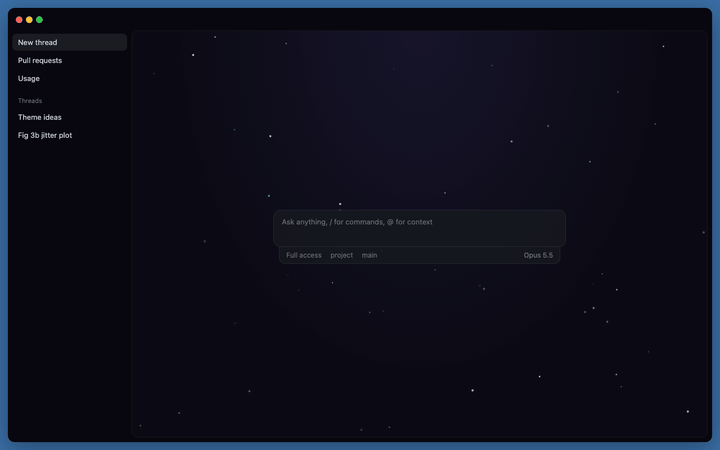
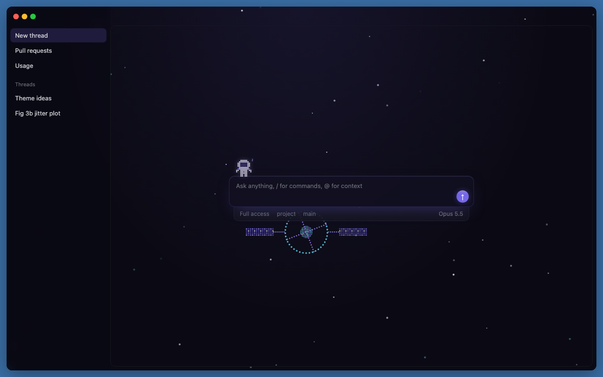
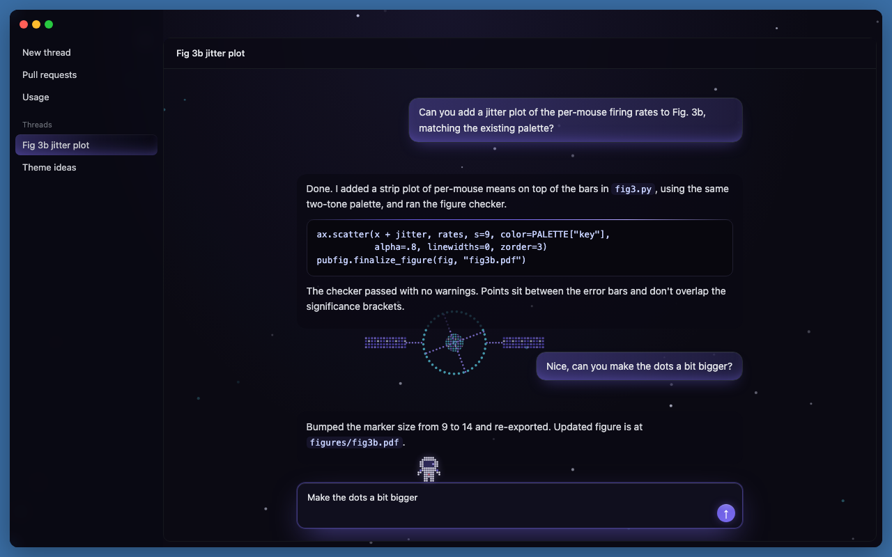
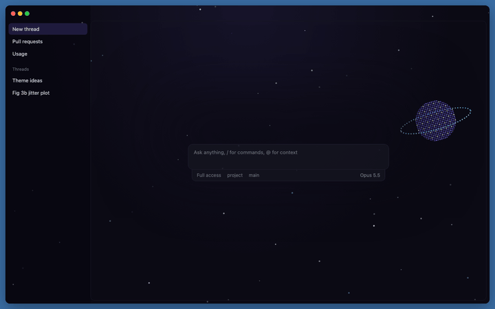
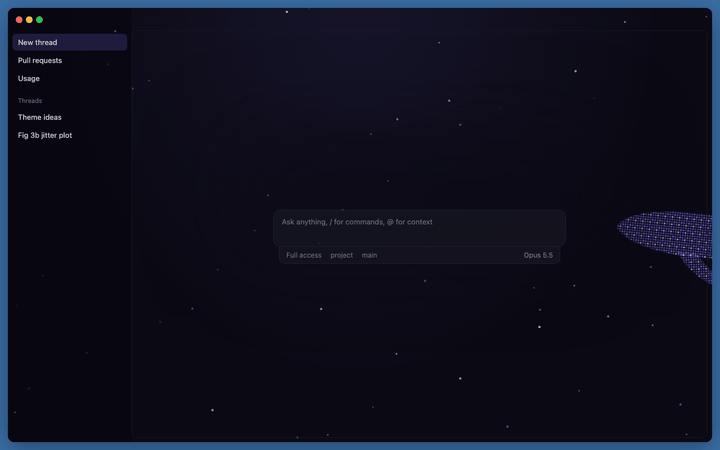
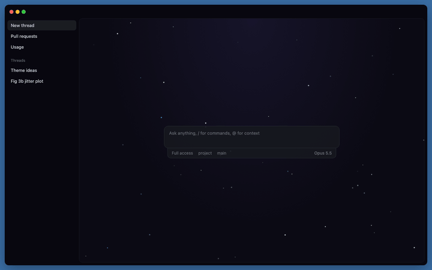
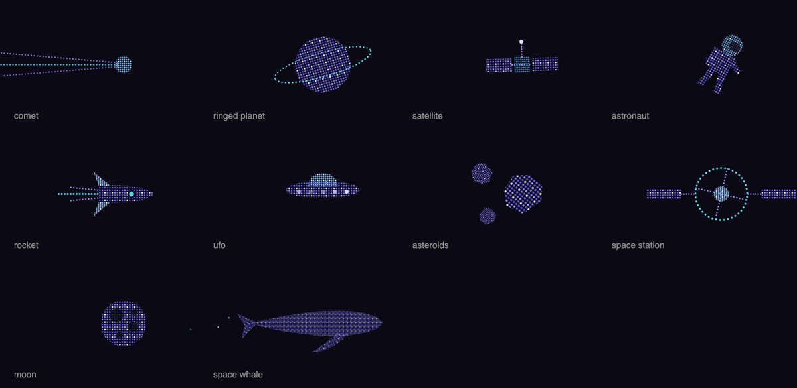
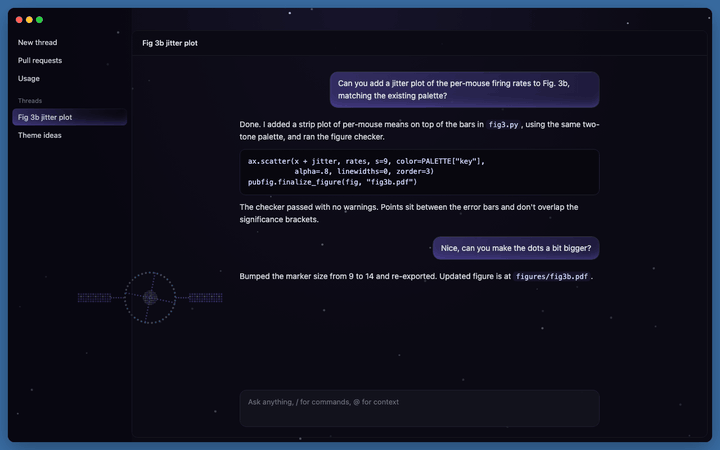

# Deep Space

A near-black violet theme with dot-matrix space objects drifting behind the whole window over a twinkling starfield. One object crosses at a time, and the next starts entering a few seconds before the last one leaves, so at most two are on screen. The loop runs about 11 minutes: three rounds, each in a different shuffled order, with every object taking a different curving route each time.

Dark mode only.



## Screenshots

| New thread | Inside a conversation |
| --- | --- |
|  |  |

## More of the show

| Ringed planet | Space whale | Rocket |
| --- | --- | --- |
|  |  |  |

## Cast



Comet, ringed planet, satellite, astronaut, rocket, UFO, asteroid cluster, space station, moon, and a dotted space whale (a nod to [Deep Sea](../deep-sea/)).

Each one has its own motion:

- The comet's three tail streaks shimmer.
- The satellite rocks gently and its beacon blinks.
- The astronaut tumbles end over end.
- The rocket's exhaust flickers.
- The UFO bobs, its rim lights chase each other, and now and then it flicks on a tractor beam.
- Each asteroid spins on its own axis.
- The space station's ring slowly turns.
- The whale beats its fluke and leaves a few sparkles behind.

White and cyan stars twinkle in the background and slowly drift.

## Inside a conversation

Once a thread has messages, the objects dim to about 40% brightness so they don't compete with the text. The empty new-thread page shows them at full strength.



If your system's "Reduce motion" setting is on, the animation is replaced with a plain dark background.

## How it works

Like every theme in this repo, the background is one animated SVG (SMIL) embedded in the theme CSS as a `data:` URL, built with the shared toolkit in [`../common/themekit.py`](../common/themekit.py):

- `Actor` and `parade()` schedule the objects so they take turns, over three shuffled rounds with a different curving route on each pass.
- `dot_pattern()` gives the dot-matrix fill: a violet texture for bodies and a cyan one for accents.
- `specks()` scatters the stars.
- `build_css()` adds the conversation dimming.

## About the previews

The screenshots and GIFs are rendered in Chrome from the theme's own CSS, placed inside a T3-style window mockup (see `../common/preview.py`). They aren't captures of the T3 Code app itself. The GIFs play in real time.

## Editing

All shapes, paths, timings and colors live in `generate.py`. After changing it, run:

```sh
python3 generate.py
```

This rewrites `background.svg`, `theme.css`, `theme.json`, `preview/gallery.svg` and `preview/timeline.json`. The toolkit checks that the SVG is valid XML and that the CSS stays under T3's 50,000-character limit. Deep Space currently uses about 20,100.

To add an object, define its body facing +x with its front near the origin, then add an `Actor(...)` to the `cast` list. Use `rotate=False` for things that should keep their orientation (planets, the UFO), and `flip=True` for side-view bodies that travel right to left.
