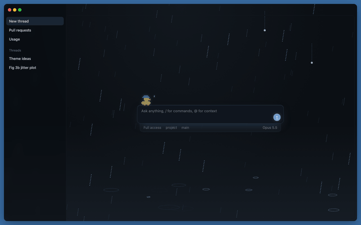
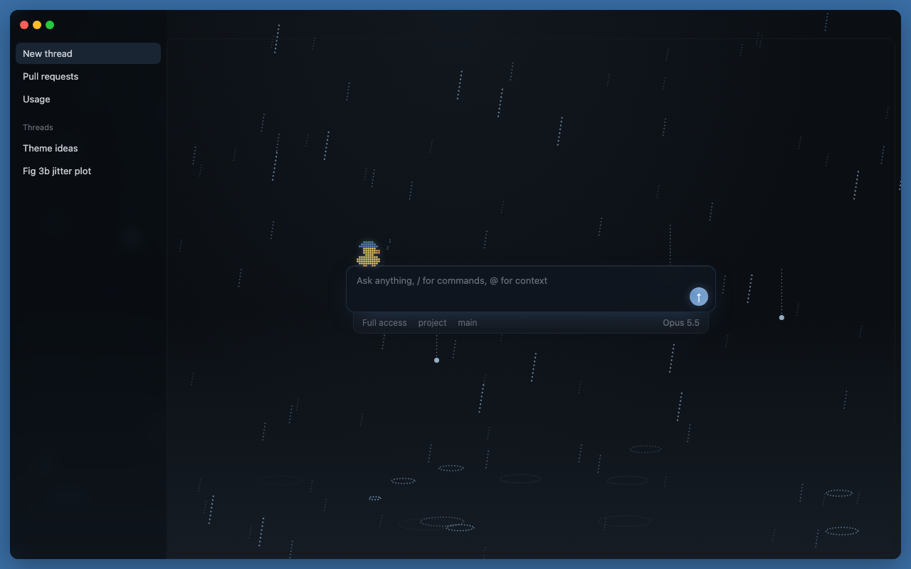
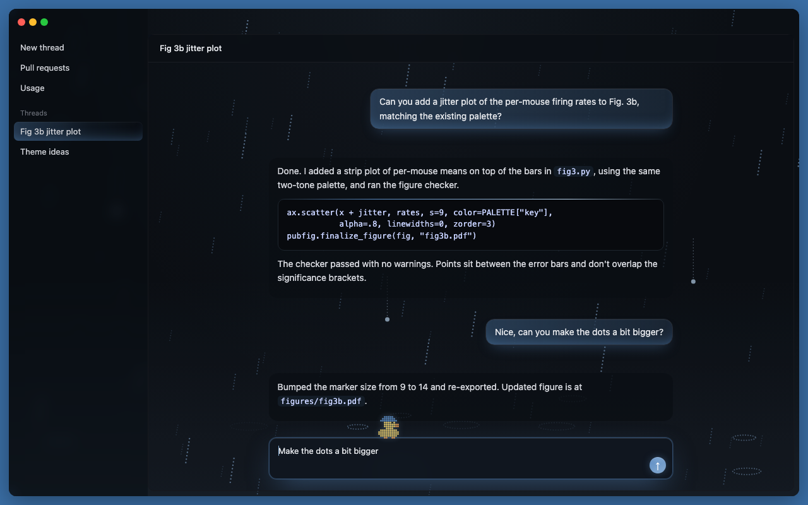
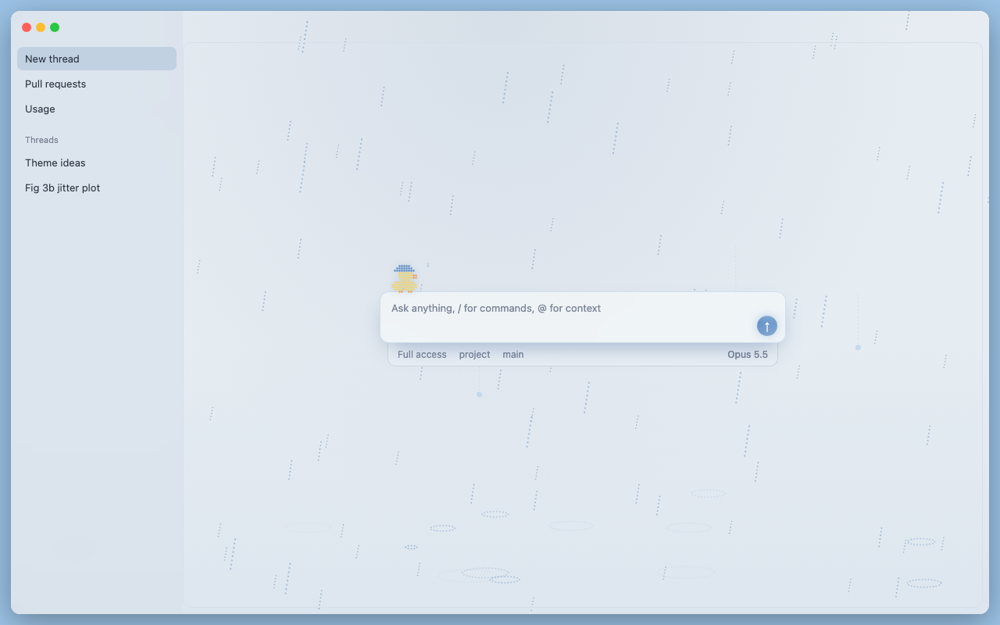
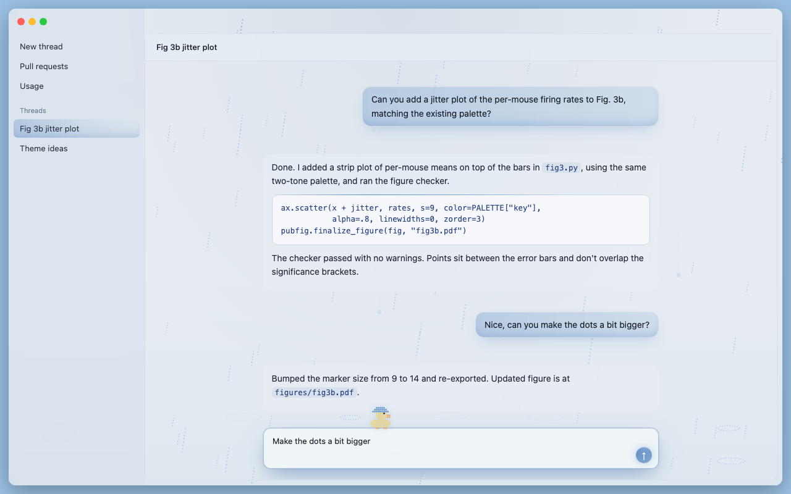
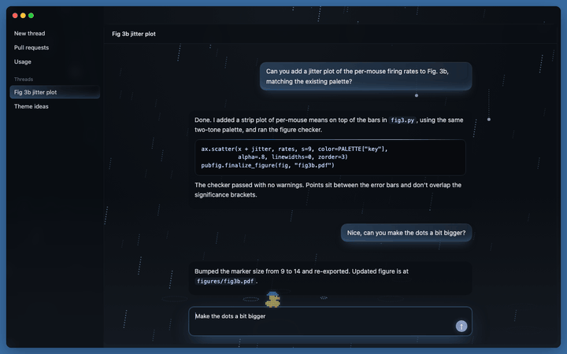

# Night Rain Calm

[Night Rain](../night-rain/) with nothing crossing the screen: layered rain, ripples, drops on the glass and far-off lightning, without the paper boat, gull, umbrella and leaf. Same colors, glass, reading cards and companion (a duck in a rain hat on the composer), and the same light mode. For when you like the look but want the background to stay quiet.



## Screenshots

| | New thread | Inside a conversation |
| --- | --- | --- |
| **Dark** |  |  |
| **Light** |  |  |

## Inside a conversation



If your system's "Reduce motion" setting is on, the animation is replaced with a plain background.

## Editing

This folder is written by [`../night-rain/generate.py`](../night-rain/generate.py), together with Night Rain; edit the scene there. Then, from the repo root:

```sh
python3 night-rain/generate.py
python3 common/preview.py night-rain-calm --still 40
```
