# Night Rain

Calm rain behind the whole window. Three layers of dotted rain fall at a slight angle, ripples spread across the ground, drops slide slowly down the glass, and a faint flash of distant lightning passes about once a minute. Now and then something drifts by in the rain, with long stretches of plain rain in between. Dark mode is a deep blue-gray night; light mode is an overcast afternoon.

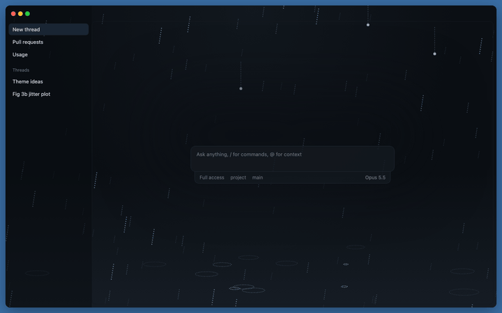

## Screenshots

| | New thread | Inside a conversation |
| --- | --- | --- |
| **Dark** | 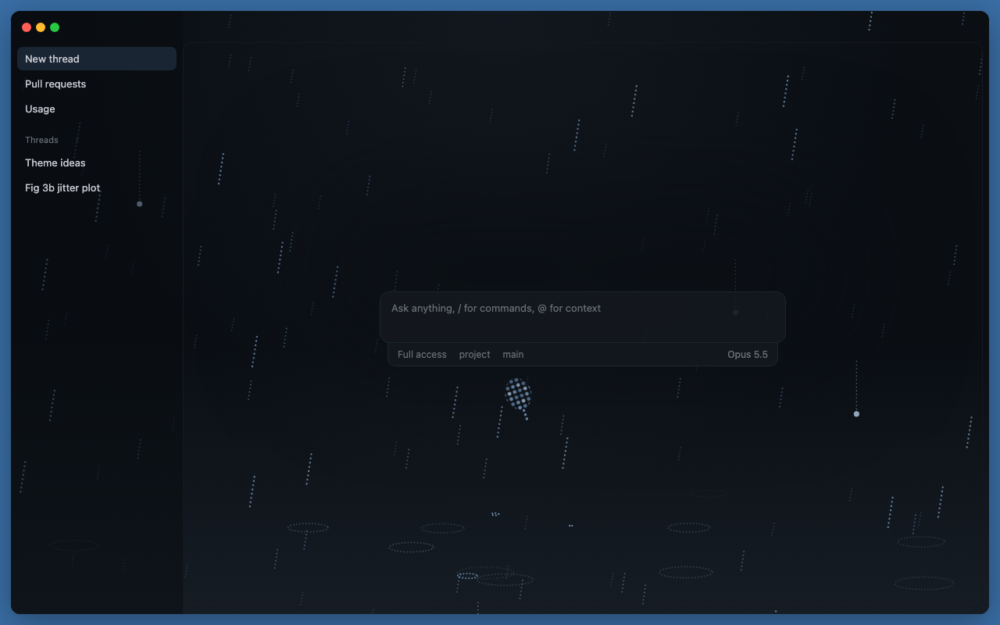 | 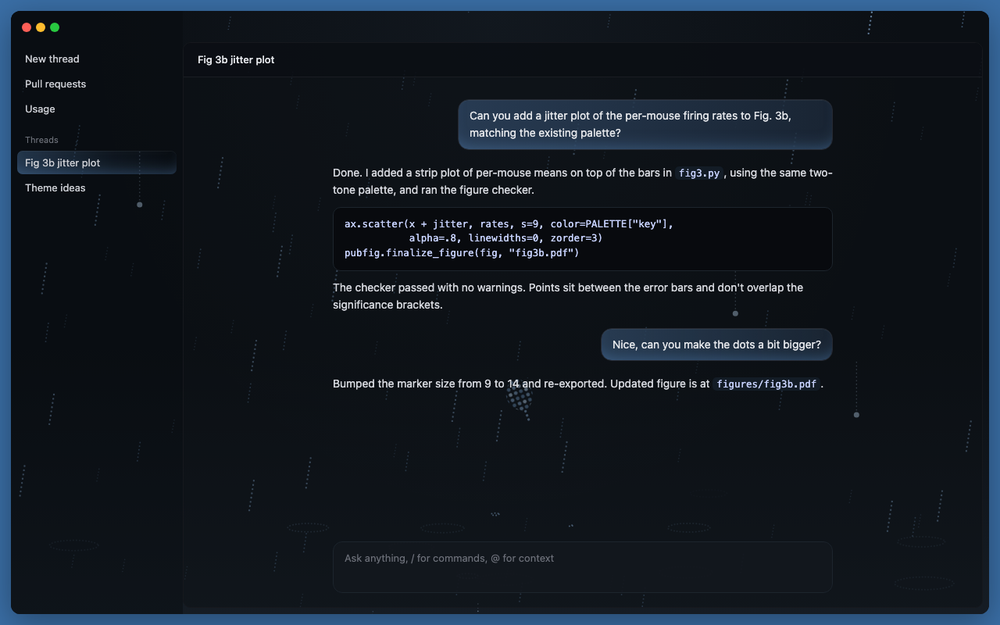 |
| **Light** | 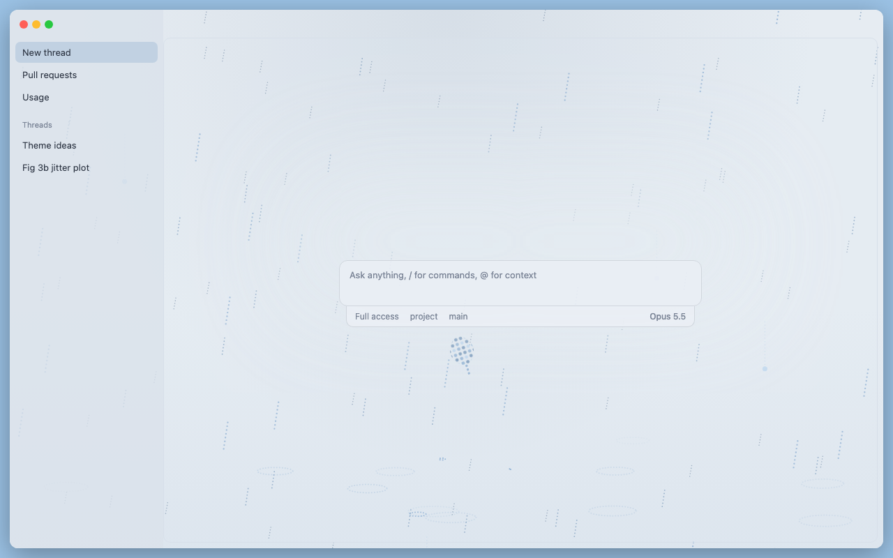 | 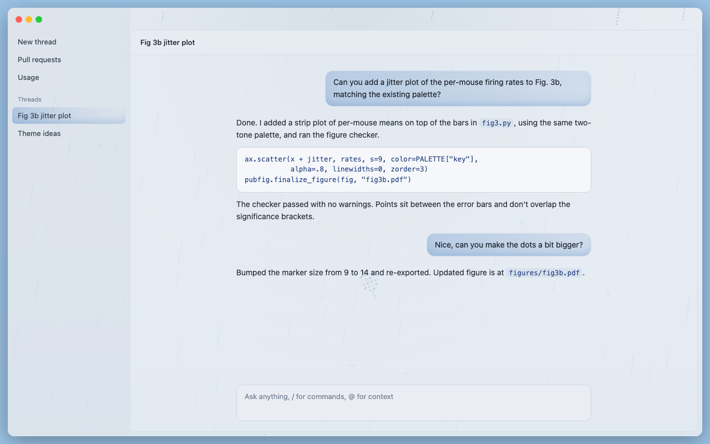 |

## What's in the rain

- **Rain:** three depth layers. Far rain is small, faint and slow; near rain is longer, brighter and faster. Each layer loops seamlessly.
- **Ripples:** dotted rings that spread and fade on the ground, on staggered timers so they never sync up.
- **Drops on the glass:** a few drops trickle down with a short trail, wandering a little side to side.
- **Lightning:** a very faint double flicker across the whole background about once a minute. It is deliberately subtle.
- **Passers-by:** a paper boat floating along the bottom, a gull, a lost umbrella, and a falling leaf. They take turns in three shuffled rounds, each pass on a different curving route (the boat stays on the water), with about 14 seconds of plain rain between them. The loop is about 7½ minutes.

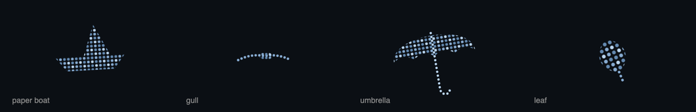

| Paper boat | Umbrella | Lightning |
| --- | --- | --- |
| 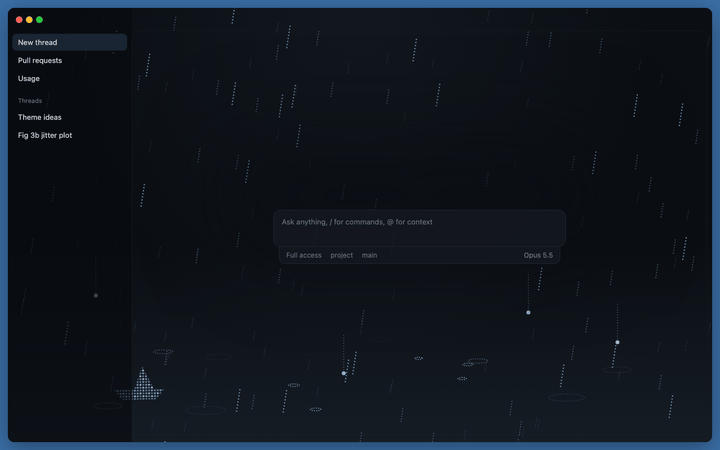 | 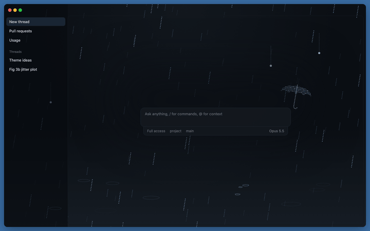 | 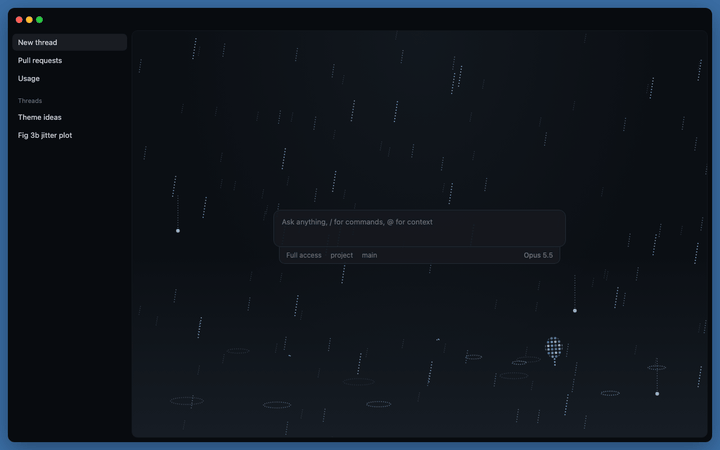 |

## Inside a conversation

Once a thread has messages, a veil softens the rain so it doesn't compete with the text. The empty new-thread page shows it at full strength.

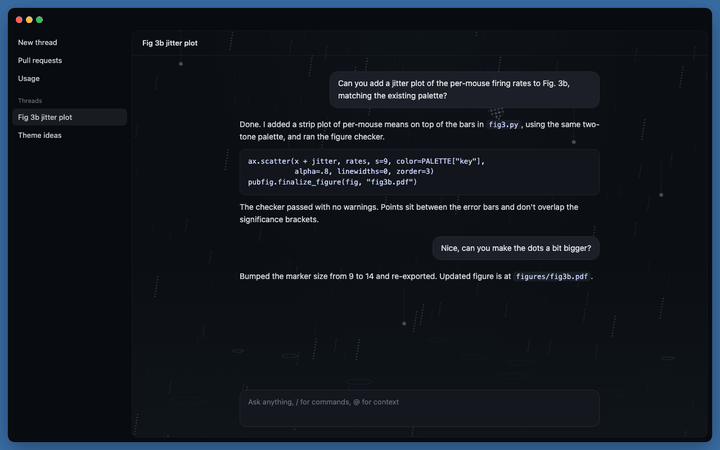

If your system's "Reduce motion" setting is on, the animation is replaced with a plain background.

## Light mode

Dark is the main appearance. In light mode the same rain falls over pale blue-gray, like a rainy afternoon, and the lightning all but disappears.

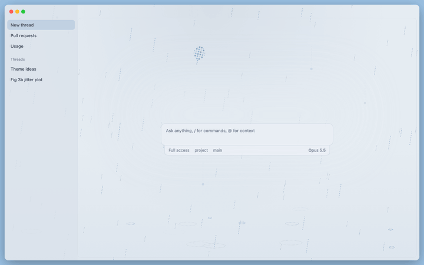

## How it works

Like every theme in this repo, the background is one animated SVG embedded in the theme CSS. See [`../common/themekit.py`](../common/themekit.py) for the shared pieces.

- Each rain layer is a single path of short slanted streaks drawn with a dotted stroke. The path is drawn twice, one screen-height apart, and the pair slides down exactly one screen-height per cycle (shifting sideways by the same slant), so the loop has no seam.
- Ripples animate an ellipse's radii and opacity; each has its own duration and start offset.
- The passers-by use the shared `parade()` with a negative `overlap`, which leaves a gap of plain rain between them instead of overlapping.

## Editing

Everything lives in `generate.py`: the rain layers (count, streak length, color, speed), ripples, glass drops, lightning timing and the passers-by. After changing it, run from the repo root:

```sh
python3 night-rain/generate.py
python3 common/preview.py night-rain      # optional: re-render the previews
```

The CSS currently uses about 15,900 of T3's 20,000 characters, so there's room for another passer-by or two.

## About the previews

The screenshots and GIFs are rendered in Chrome from the theme's own CSS, placed inside a T3-style window mockup. They aren't captures of the T3 Code app itself. The GIFs play in real time, at 7 frames per second, so the fast near rain looks choppier than it does in the app.
