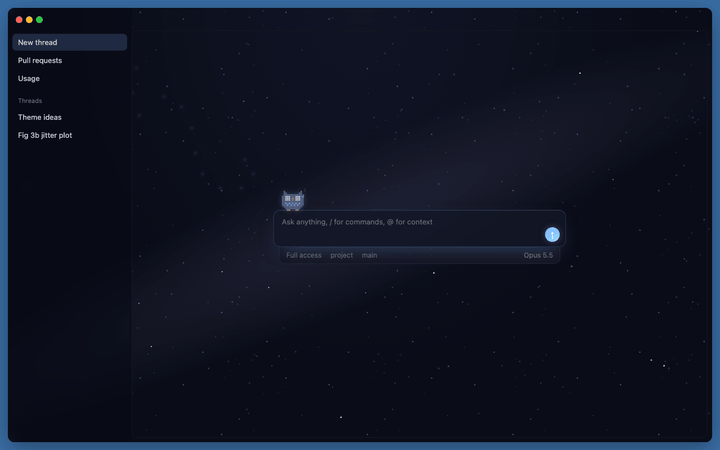
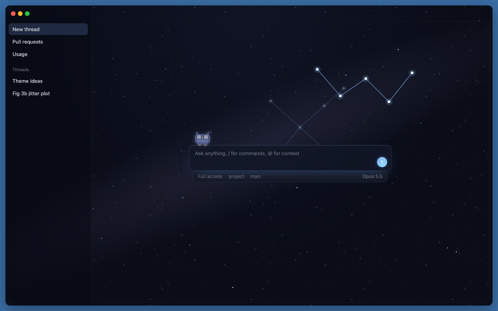
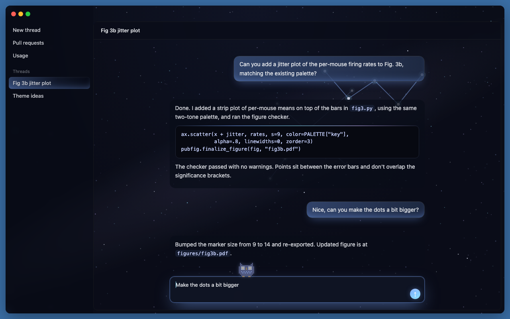
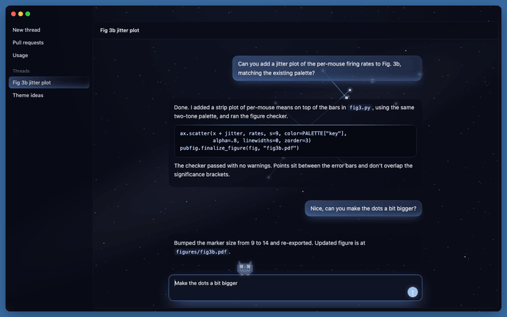

# Night Sky Calm

[Night Sky](../night-sky/) with nothing crossing the screen: a calm starfield where constellations slowly draw themselves, without the shooting stars, comet and satellite. Same colors, glass, reading cards and companion (an owl on the composer). For when you like the look but want the background to stay quiet.



## Screenshots

| | New thread | Inside a conversation |
| --- | --- | --- |
| **Dark** |  |  |

## Inside a conversation



If your system's "Reduce motion" setting is on, the animation is replaced with a plain background.

## Editing

This folder is written by [`../night-sky/generate.py`](../night-sky/generate.py), together with Night Sky; edit the scene there. Then, from the repo root:

```sh
python3 night-sky/generate.py
python3 common/preview.py night-sky-calm --still 40
```
