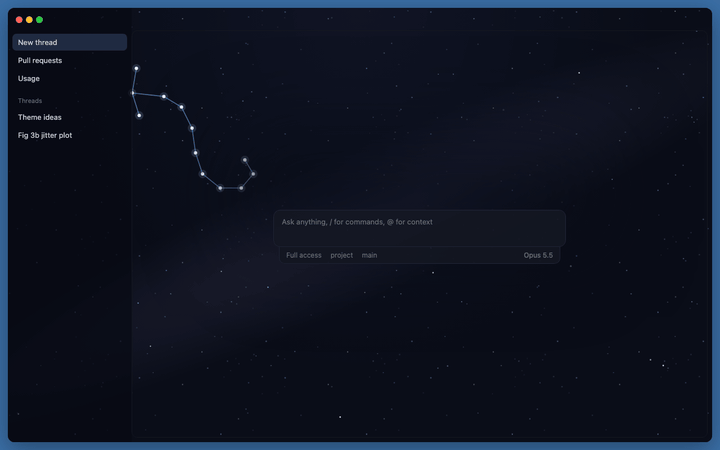
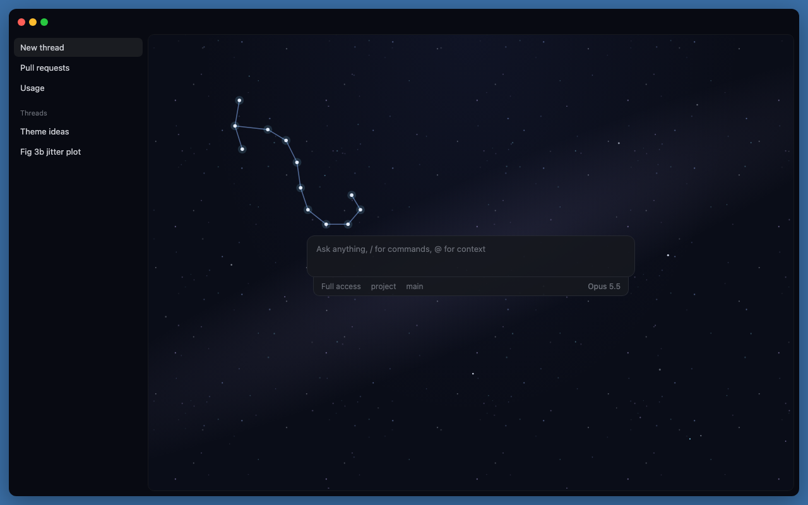
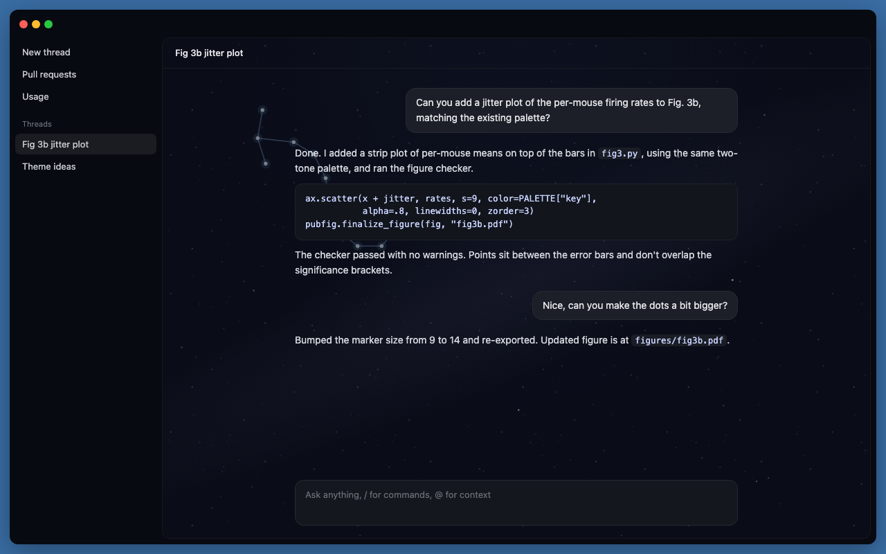
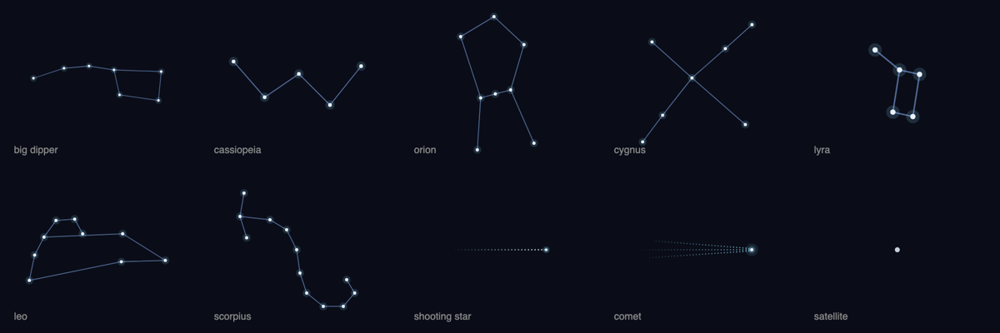
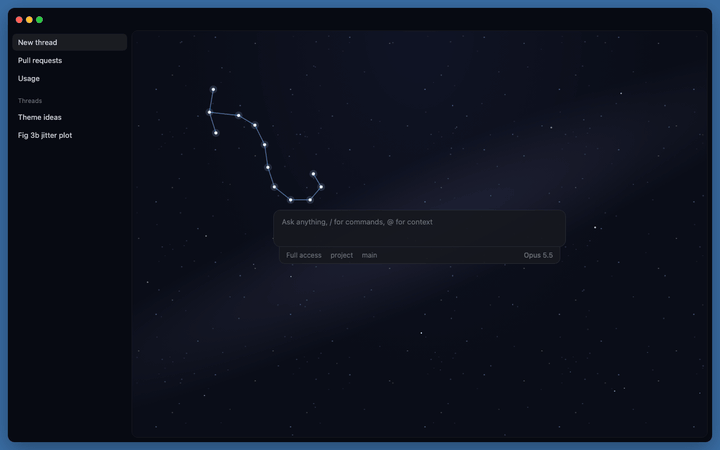
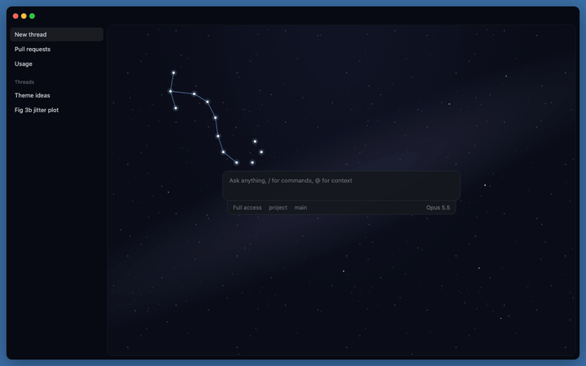
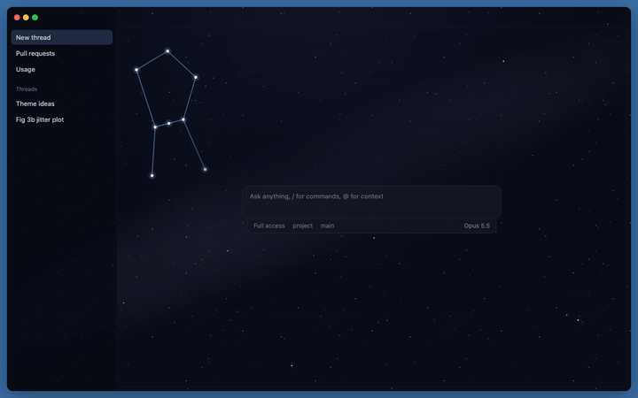
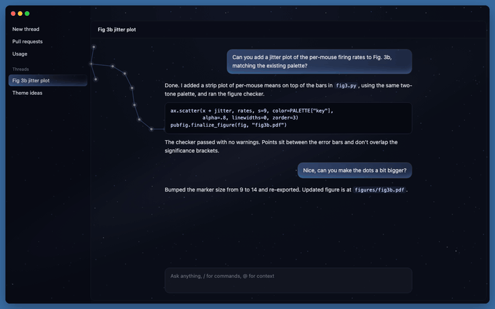

# Night Sky

A calm, clear night behind the chat. A slowly turning starfield with a faint Milky Way, constellations that take turns drawing themselves line by line, and the occasional shooting star, satellite or comet. Dark mode only.



## Screenshots

| New thread | Inside a conversation |
| --- | --- |
|  |  |

## What's in the sky



- **Constellations:** Big Dipper, Cassiopeia, Orion, Cygnus, Lyra, Leo and Scorpius. Each one fades in, draws its lines over about seven seconds, holds, then fades out. The next one starts while the last is still up, so one or two are visible at a time, each in a different part of the sky. They come in three rounds, each in a shuffled order, so the full loop is about 5½ minutes.
- **Shooting stars:** a quick streak with a fading dotted tail every 20 to 40 seconds, from a different spot each time.
- **Satellite:** a small blinking dot that drifts across the whole sky twice per loop.
- **Comet:** once per loop, a slow comet with a dotted, fanned tail crosses the upper sky.
- **Stars:** two tiled layers of faint stars plus a few dozen brighter ones that twinkle. The whole sky drifts very slowly, like the Earth turning.

| A constellation drawing itself | Shooting star | Comet |
| --- | --- | --- |
|  |  |  |

## Inside a conversation

Once a thread has messages, the sky dims a little so it doesn't compete with the text. The empty new-thread page shows it at full strength.



If your system's "Reduce motion" setting is on, the animation is replaced with a plain night-blue background.

## How it works

Like every theme in this repo, the background is one animated SVG embedded in the theme CSS (see [`../common/themekit.py`](../common/themekit.py)).

- Constellation lines use `pathLength='1'` with `stroke-dasharray='1'`, and animate `stroke-dashoffset` from 1 to 0 to draw themselves. Each constellation jumps to a new spot (a discrete `animateTransform`) while it's invisible between appearances.
- All constellations share one timeline the length of the loop, so their turns never overlap by more than two.
- Shooting stars, the satellite and the comet each use a single `animateMotion` whose path has one subpath per appearance. That's the same multi-pass trick `themekit.parade()` uses.
- The faint stars are two SVG `<pattern>` tiles of different sizes laid over each other, which keeps the CSS small without an obvious repeat.

## About the previews

The screenshots and GIFs are rendered in Chrome from the theme's real CSS, inside a T3-style window mockup (`../common/preview.py`). They aren't captures of the T3 Code app itself. The GIFs play in real time.

## Editing

Constellation shapes, colors and timings live in `generate.py`. After changing it, run:

```sh
python3 generate.py
python3 ../common/preview.py .   # optional: refresh the screenshots and GIFs
```

The CSS is at about 19,400 of T3's 20,000-character limit, so there's little room for more constellations unless something else gets trimmed. Fewer twinkling stars, or a smaller star tile, would free up space.
